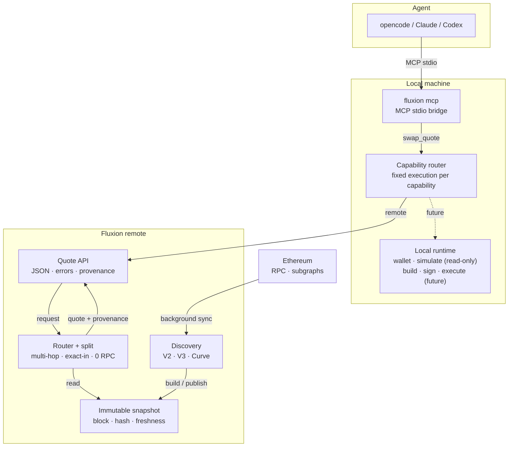

# Fluxion

**The open capability layer between AI agents and Web3.**

English · [中文](README.md)


One MCP interface. Fresh onchain data. Keys stay local.

Fluxion gives AI agents a safe, structured way to use Web3. It is not another agent, wallet or
DeFi dashboard; it is the capability layer between them.

## What is Fluxion

Fluxion turns Web3 actions into stable capabilities. Agents do not need to learn every protocol,
and they do not need access to private keys.

- **Agents see one interface.** `fluxion mcp` exposes capabilities as MCP tools.
- **Market-data work runs remotely.** Protocol discovery, quotes and risk come from a warm remote
  service.
- **User-controlled work stays local.** Wallet access, authorization, signing and execution belong
  in the user's environment.
- **Execution location is fixed per capability.** Agents and users do not choose local or remote.

The first capability is `swap.quote`: exact-in multi-hop quotes on Ethereum mainnet. It is
read-only and never signs, approves or broadcasts.

## Why Fluxion

- **Agent-native** — one MCP interface instead of one SDK per protocol.
- **Fresh, not stale** — quotes come from a warm remote service, not a cold local rebuild.
  Methodology and data: [swap.quote benchmark](docs/capabilities/swap/README.md#latest-benchmark).
- **Safe by boundary** — read-only market data can be remote; wallet access, authorization,
  signing and execution belong to the local runtime. The agent never chooses where a capability
  runs.
- **Structured for tools** — stable JSON, error codes, schemas and Skills instead of screenshots
  and prose.
- **Open and inspectable** — Rust engine, benchmark corpus, JSON schemas and reproducible mainnet
  tests.

## How it works

`swap.quote` separates the request path from background state sync: a request reads one published
immutable snapshot, and the quote computation performs no RPC.



`swap.quote` is read-only. It never signs, approves or broadcasts.

## Today

`swap.quote` is available: exact-in quotes, multi-hop routing, split allocation and state
freshness on Ethereum mainnet. Full inputs, outputs, errors and the latest benchmark:
[swap.quote](docs/capabilities/swap/README.md).

`wallet.balance` and `wallet.assets` provide local read-only ETH/ERC20 balances and holdings;
`wallet.allowance` reads owner/spender allowances; `wallet.collectibles` reads NFT holdings.
`transaction.simulate` provides local read-only calldata simulation. See
[wallet](docs/capabilities/wallet/README.md) and
[transaction](docs/capabilities/transaction/README.md).

## Get started

```bash
cargo install --path crates/client
fluxion mcp
```

The remote service is deployed separately; `fluxion mcp` never starts it. Local testing, MCP
registration and Skills setup: [docs/MCP.md](docs/MCP.md).

With a running remote:

```bash
FLUXION_REMOTE_URL=http://127.0.0.1:8080 fluxion swap ldo-eth 100 --json
```

## Capabilities

| Capability | Status | Docs |
|---|---|---|
| `swap.quote` | available | [swap.quote](docs/capabilities/swap/README.md) |
| `wallet.balance` | available | [wallet](docs/capabilities/wallet/README.md) |
| `wallet.assets` | available | [wallet](docs/capabilities/wallet/README.md) |
| `wallet.allowance` | available | [wallet](docs/capabilities/wallet/README.md) |
| `wallet.collectibles` | available | [wallet](docs/capabilities/wallet/README.md) |
| `transaction.simulate` | available | [transaction](docs/capabilities/transaction/README.md) |
| `swap.build` | planned | — |
| `swap.simulate` | planned | — |
| `swap.execute` | planned | — |

Execution location is fixed per capability. Agents and users do not select local/remote.
See [product architecture](docs/PRODUCT-ARCHITECTURE.md).

## Who it is for

- Builders of AI agents, plugins and tools
- Wallets, custody and agent infrastructure teams
- DeFi protocols that want safe agent-native access

## Documentation

- **Start here**: [MCP](docs/MCP.md) · [swap.quote](docs/capabilities/swap/README.md) · [wallet](docs/capabilities/wallet/README.md) · [transaction](docs/capabilities/transaction/README.md) · [product architecture](docs/PRODUCT-ARCHITECTURE.md)
- **Vision**: [whitepaper](docs/WHITEPAPER.md) · [architecture](docs/ARCHITECTURE.en.md) · [local state](docs/LOCAL-STATE.md)
- **Operations**: [HTTP API](docs/API.md) · [configuration](docs/CONFIGURATION.md) · [development](docs/DEVELOPMENT.md)
- **Research**: [benchmarks](docs/benchmarks/README.md) · [multi-pool](docs/MULTI-POOL.md) · [split routing](docs/SPLIT-ROUTING.md) · [quote quality](docs/QUOTE-QUALITY.md)
- **Boundaries**: [limitations](docs/LIMITATIONS.md) · [swap schema](schemas/swap_quote.v1.json) ·
  [wallet schema](schemas/wallet_balances.v1.json) ·
  [allowance schema](schemas/wallet_allowances.v1.json) ·
  [collectibles schema](schemas/wallet_collectibles.v1.json) ·
  [transaction schema](schemas/transaction_simulate.v1.json) · [swap skill](skills/swap/SKILL.md) ·
  [wallet skill](skills/wallet/SKILL.md) · [transaction skill](skills/transaction/SKILL.md)

## Status

Pre-1.0. Ethereum mainnet. `swap.quote`, `wallet.balance`, `wallet.assets`, `wallet.allowance`,
`wallet.collectibles` and `transaction.simulate` are available and read-only. `swap.build` and
`swap.execute` are the next local-runtime milestones.
