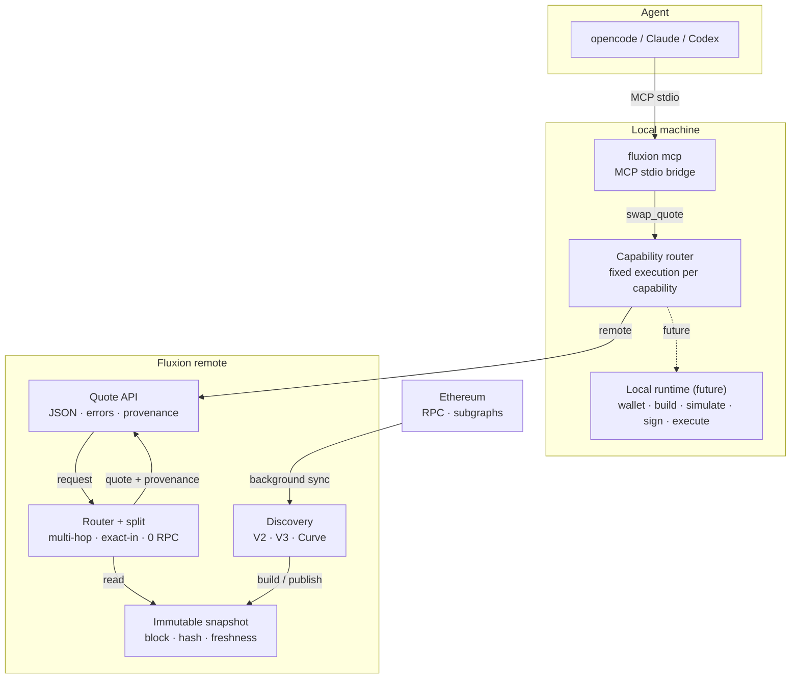

# Fluxion

**The open capability layer between AI agents and Web3.**

[English](README.en.md) · 中文


一个 MCP 接口。新鲜的链上数据。密钥和签名留在本地。

Fluxion 让 AI Agent 以安全、结构化的方式使用 Web3。它不是另一个 Agent、钱包或 DeFi 面板，
而是位于它们之间的 capability layer。

## Fluxion 是什么

Fluxion 把 Web3 动作变成稳定的 capability。Agent 不需要学习每个协议，也不需要接触私钥。

- **Agent 只看到一个接口。** `fluxion mcp` 把 capability 暴露为 MCP tool。
- **只读能力集中到 remote。** 协议发现、链上数据、报价和风险由预热好的服务完成。
- **需要用户控制的能力留在 local runtime。** 钱包、授权、签名和执行属于用户环境。
- **执行位置由 capability 决定。** Agent 和用户都不选择 local/remote。

第一个 capability 是 `swap.quote`：Ethereum 主网的 exact-in 多跳报价。它只读，不签名、
不授权、不广播。

## 为什么是 Fluxion

- **Agent-native** — 一个 MCP 接口，而不是每个协议一套 SDK。
- **Fresh, not stale** — 报价来自已经预热的 remote 服务，而不是每次冷启动重建。
  方法与数据见 [swap.quote benchmark](docs/capabilities/swap/README.md#latest-benchmark)。
- **Safe by boundary** — 只读行情可以走 remote；钱包、授权、签名和执行属于 local runtime。
  Agent 不选择执行位置。
- **Structured for tools** — 稳定 JSON、错误码、schema 和 Skills，而不是截图和散文。
- **Open and inspectable** — Rust 引擎、benchmark 语料、JSON schema、可复现的主网测试。

## 如何工作

`swap.quote` 的请求链路和后台状态链路是分开的：请求只读取一个已发布的不可变快照，
计算阶段不访问 RPC。



`swap.quote` 是只读的，不会签名、授权或广播。

## 今天

`swap.quote` 已可用：Ethereum 主网 exact-in、多跳、拆单和状态新鲜度。完整输入输出、错误和
最新 benchmark 见 [swap.quote](docs/capabilities/swap/README.md)。`wallet.balance` 和
`wallet.assets` 提供本地只读 ETH/ERC20 余额与持仓发现，`wallet.allowance` 提供
owner/spender allowance 查询；见 [wallet](docs/capabilities/wallet/README.md)。
`transaction.simulate` 提供本地只读 calldata 模拟，见
[transaction](docs/capabilities/transaction/README.md)。

## 快速开始

```bash
cargo install --path crates/client
fluxion mcp
```

Remote service 独立部署，`fluxion mcp` 不会启动它。本地测试、MCP 注册和 Skills 配置见
[docs/MCP.md](docs/MCP.md)。

已有 remote 时：

```bash
FLUXION_REMOTE_URL=http://127.0.0.1:8080 fluxion swap ldo-eth 100 --json
```

## Capabilities

| Capability | 状态 | 文档 |
|---|---|---|
| `swap.quote` | available | [swap.quote](docs/capabilities/swap/README.md) |
| `wallet.balance` | available | [wallet](docs/capabilities/wallet/README.md) |
| `wallet.assets` | available | [wallet](docs/capabilities/wallet/README.md) |
| `wallet.allowance` | available | [wallet](docs/capabilities/wallet/README.md) |
| `transaction.simulate` | available | [transaction](docs/capabilities/transaction/README.md) |
| `swap.build` | planned | — |
| `swap.simulate` | planned | — |
| `swap.execute` | planned | — |

执行位置按 capability 固定，Agent 和用户都不选择 local/remote。
详见 [product architecture](docs/PRODUCT-ARCHITECTURE.md)。

## 适合谁

- 构建 AI Agent、插件和工具的开发者
- 钱包、托管和 Agent 基础设施团队
- 希望被 Agent 安全调用的 DeFi 协议

## 文档

- **从这里开始**：[MCP](docs/MCP.md) · [swap.quote](docs/capabilities/swap/README.md) · [wallet](docs/capabilities/wallet/README.md) · [transaction](docs/capabilities/transaction/README.md) · [产品架构](docs/PRODUCT-ARCHITECTURE.md)
- **愿景**：[白皮书](docs/WHITEPAPER.md) · [架构](docs/ARCHITECTURE.md) · [本地状态](docs/LOCAL-STATE.md)
- **运维**：[HTTP API](docs/API.md) · [配置](docs/CONFIGURATION.md) · [开发](docs/DEVELOPMENT.md)
- **研究**：[benchmarks](docs/benchmarks/README.md) · [multi-pool](docs/MULTI-POOL.md) · [split routing](docs/SPLIT-ROUTING.md) · [quote quality](docs/QUOTE-QUALITY.md)
- **边界**：[limitations](docs/LIMITATIONS.md) · [swap schema](schemas/swap_quote.v1.json) ·
  [wallet schema](schemas/wallet_balances.v1.json) ·
  [allowance schema](schemas/wallet_allowances.v1.json) ·
  [transaction schema](schemas/transaction_simulate.v1.json) · [swap skill](skills/swap/SKILL.md) ·
  [wallet skill](skills/wallet/SKILL.md) · [transaction skill](skills/transaction/SKILL.md)

## 状态

Pre-1.0。Ethereum mainnet。`swap.quote`、`wallet.balance`、`wallet.assets` 和
`transaction.simulate` 已可用，只读。`swap.build` / `execute` 和 `wallet.collectibles` 是
下一阶段的 local runtime 里程碑。
