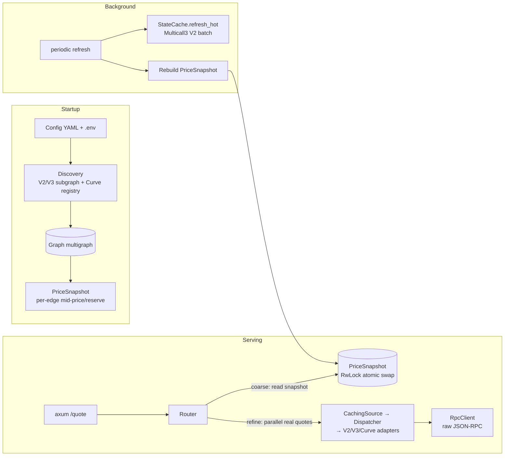
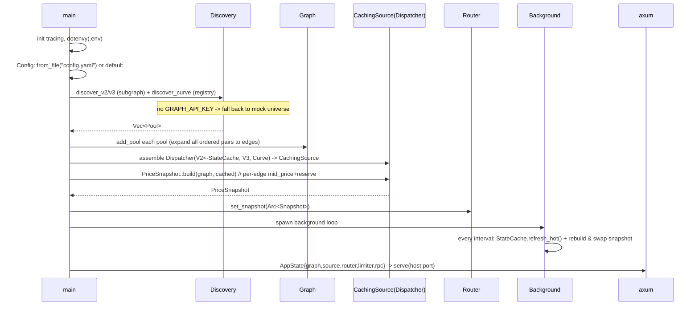

# Fluxion Architecture Design

English | [中文](ARCHITECTURE.md)

> This document explains **how Fluxion works**: startup, pool discovery, building the
> multigraph, warming a price snapshot, and the full data flow of a `/quote` request —
> including how caches, RPC, and concurrency are organized.
>
> Function-by-function trace: [`REQUEST-TRACE.en.md`](REQUEST-TRACE.en.md).
>
> Audience: anyone who wants to read or modify this project. The code (`src/`) is the
> source of truth; this is the map.

---

## 1. In one sentence

Fluxion is an **Ethereum mainnet multi-hop routing quote (RFQ) service**: given
`token_in` / `token_out` / `amount_in`, it searches a **directed multigraph** of Uniswap V2/V3
and Curve pools for the **single best path** and returns an exact `amount_out` (exact-in).
It is **open-source and self-hosted**: one YAML config plus your own RPC / Graph key.

Core idea — **two-layer pricing**:
- **Coarse**: use an in-memory **price snapshot** (mid-prices) for fast graph search, **zero RPC**.
- **Refine**: for a small set of candidate paths only, call the real on-chain quote (slippage +
  fees included) and take the best.

---

## 2. Glossary

| Term | Meaning |
|---|---|
| Token | An ERC-20 token (identified by `Address`) |
| Pool | An on-chain liquidity pool; `coins: Vec<Address>`, 2–4 tokens |
| PoolKind | Platform type: `UniswapV2 / UniswapV3{fee} / Curve` |
| Edge | **Directed**: within a pool, "sell coin index i → buy coin index j" |
| Multigraph | The same token pair on multiple platforms/pools = multiple **parallel edges** |
| mid-price | Zero-slippage spot price (V2=reserve ratio, V3=slot0, Curve=small dy/dx) |
| exact-in | Given an input amount, maximize output |
| coarse / refine | Coarse (graph search) / refine (real on-chain quote) |
| snapshot | Precomputed per-edge `(mid_price, reserve)` used by the coarse stage |
| hop | One edge along a path |

---

## 3. Components



Modules and responsibilities:

| Module | Responsibility |
|---|---|
| `config.rs` | Load YAML config + defaults |
| `main.rs` | Startup orchestration: discover → build graph → build snapshot → spawn background → serve |
| `discovery.rs` | Discover + filter pools from subgraphs (V2/V3) and the Curve registry |
| `model.rs` | Domain types (Token/Pool/Edge/Hop/Route/QuoteRequest) |
| `graph.rs` | Multigraph: adjacency, parallel edges, multi-coin expansion |
| `source.rs` | `QuoteSource` trait (quote interface) + mock impls |
| `adapters.rs` | Real adapters V2/V3/Curve + `Dispatcher` + `CachingSource` |
| `state.rs` | `StateCache`: V2 reserve TTL cache + Multicall3 batch refresh |
| `rpc.rs` | Raw JSON-RPC client (`eth_call`/`eth_blockNumber` + retries) |
| `router.rs` | Snapshot + K-best DP coarse + parallel refine + price impact |
| `api.rs` | axum routes, DTOs, error mapping, rate limiting, `/health`, `/ready` |
| `util.rs` | ABI encoding, hex, numeric conversion |

---

## 4. Runtime lifecycle



Notes:
- **Startup blocks on discovery + snapshot build** (a few seconds to ~15s depending on pool
  count and RPC).
- The **background loop** (every `refresh_interval_secs`, default 30s) refreshes two things:
  V2 reserves (Multicall3 batch) and the entire price snapshot (keeps coarse prices fresh).

---

## 5. Data model (`model.rs`)

```rust
struct Token { address: Address, symbol: String, decimals: u8 }

enum PoolKind { UniswapV2, UniswapV3 { fee: u32 }, Curve }

struct Pool { kind: PoolKind, address: Address, coins: Vec<Address> }

struct Edge { pool_idx: usize, i: usize, j: usize }   // pool + sell index i + buy index j

struct Hop { pool: Pool, i, j, token_in, token_out, amount_in: U256, amount_out: U256 }

struct Route { hops: Vec<Hop>, amount_out: U256, price_impact_bps: i64 }
```

Amounts are `U256` (decimal strings at the API boundary). Token `decimals` are not used in
the math — quote functions take raw base units and chain `amount_out` → next `amount_in`.

---

## 6. Multigraph (`graph.rs`)

```rust
struct Graph {
  tokens: HashMap<Address, usize>,   // token -> node id
  token_addrs: Vec<Address>,         // id -> token
  pools: Vec<Pool>,
  edges: Vec<Edge>,
  out_edges: HashMap<usize, Vec<usize>>, // node id -> out-edge indices
}
```

**Building** (`add_pool`):
- Register each coin as a node;
- Generate **every ordered pair (i,j), i≠j** in `coins` as an edge:
  - V2/V3 (2 coins) → 2 directed edges;
  - Curve 3pool (3 coins) → 6; 4 coins → 12.
- The same token pair from different pools/platforms → **parallel edges** (multigraph).

**Why a custom adjacency list**: edge weights are request-dependent (amount-sensitive penalty),
and we need full control over parallel edges and direction; petgraph gets in the way.
Queries use `out_edge_indices(token)` → out-edge list.

---

## 7. Pool discovery & filtering (`discovery.rs`)

Three sources are collected into a `Vec<Pool>`:

| Platform | Source | Ordering / filters |
|---|---|---|
| Uniswap V2 | The Graph V2 subgraph (paginate 200/page) | `reserveUSD_gt`, optional `volumeUSD_gt`, `createdAtTimestamp_lt` |
| Uniswap V3 | The Graph V3 subgraph (paginate) | **order by `volumeUSD`** (TVL ordering surfaces junk), `totalValueLockedUSD_gt`, ... |
| Curve | Main stableswap registry: `AddressProvider.get_registry()` → `pool_count/pool_list` → `coins(i)` | validate each pool with one `get_dy` probe; every coin must be allowlisted |

**Filtering**
- **Default major-token allowlist** (~14 built-in: WETH/WBTC/USDC/USDT/DAI/USDS/stETH/wstETH/
  LINK/UNI/AAVE/MKR/CRV/LDO). V2/V3 require **both** coins in the allowlist; Curve requires
  **all** coins. Override via `token_allowlist`.
- Thresholds: `min_liquidity`, `min_volume_24h` (uses subgraph `volumeUSD` as a proxy),
  `min_pool_age_days`.
- `max_pools`: per-platform cap, bounds graph size and RPC cost.
- `enabled_platforms`: only discover enabled platforms.

> Why the allowlist: subgraph TVL/volume can be gamed; junk/fake pools' mid-prices would poison
> routing. The allowlist narrows the graph to trusted majors — better quality and less RPC.

---

## 8. Quote sources & adapters (`source.rs` + `adapters.rs`)

### Interface

```rust
#[async_trait]
trait QuoteSource {
  async fn amount_out(&self, pool, i, j, amount_in) -> Result<U256>; // real exact quote (slippage+fee)
  async fn mid_price(&self, pool, i, j) -> Result<f64>;              // zero-slippage spot (coarse)
  async fn reserve_in(&self, pool, i) -> Result<U256>;               // input reserve (penalty/shallow check)
}
```

### Three real adapters

- **UniswapV2** (`eth_call getReserves` → constant product):
  `amount_out = in*997*r_out/(r_in*1000 + in*997)`; `mid_price = r_out/r_in`; `reserve_in = r[i]`.
  Reserves come from `StateCache` (see §9).
- **UniswapV3** (`QuoterV2.quoteExactInputSingle`, selector `0xc6a5026a`):
  `amount_out` via QuoterV2 (handles fee/ticks); `mid_price` from `slot0.sqrtPriceX96` as
  `(sqrt/2^96)^2`; `reserve_in = U256::MAX`.
- **Curve**: try `get_dy(int128,...)` (`0x5e0d443f`), fall back to `get_dy(uint256,...)`
  (`0x556d6e9f`, crypto pools); `mid_price` from a tiny `dy/dx`; `reserve_in = U256::MAX`.

### Dispatcher

Dispatches by `pool.kind` to the right adapter (V2 always present; V3/Curve optional).
Dispatcher also implements `QuoteSource`, so it looks like a single source upstream.

### CachingSource

Wraps the Dispatcher; caches `mid_price` by `(pool,i,j)` and `reserve_in` by `(pool,i)` (TTL).
Mainly used by **PriceSnapshot rebuilds** to avoid repeated RPC within the TTL. Note:
**`amount_out` is not cached** (amount-dependent, computed live).

---

## 9. The three cache/state layers (important, easy to confuse)

| Layer | Location | Caches | Used by | Purpose |
|---|---|---|---|---|
| **StateCache** | `state.rs` | V2 reserves `[U256;2]` per pool, TTL | `UniswapV2` adapter | V2 reserve cache + Multicall3 batch refresh |
| **CachingSource** | `adapters.rs` | `mid_price`(pool,i,j) / `reserve_in`(pool,i), TTL | `PriceSnapshot::build` | second-level buffer during rebuilds |
| **PriceSnapshot** | `router.rs` | per-edge `(mid_price, reserve_in)` array | `Router` coarse | synchronous coarse reads, **zero RPC** |

Data flow:
```
Cold start / background refresh: PriceSnapshot::build
  -> per edge: CachingSource.mid_price/reserve_in
     -> (miss) Dispatcher -> adapter
        -> V2: StateCache.get_reserves (hit = zero RPC; else Multicall/single getReserves)
        -> V3: slot0 ; Curve: get_dy
  -> per-edge mid_price/reserve -> an immutable PriceSnapshot

Request coarse: read PriceSnapshot.per_edge[idx] (synchronous, microseconds)
Request refine: source.amount_out(...) (CachingSource -> Dispatcher -> adapter)
        -> V2: StateCache reserves (up to TTL old); V3: live QuoterV2; Curve: live get_dy
```

> Freshness caveat: in refine, **V2 uses reserves cached up to TTL**, while **V3/Curve are live**.
> This is a known issue (see §15).

---

## 10. Routing algorithm (`router.rs`)

### 10.1 Coarse: turn prices into edge weights

For each edge `e` compute a cost (lower is better):

```
w(e) = -ln(mid_price) + fee_penalty(kind) + λ·(amount_in / reserve_in)
```

- `-ln(mid_price)`: maximize `∏rate` ⟺ minimize `∑ -ln(rate)`; **can be negative** (rate>1).
- `fee_penalty`: approximate per-hop fee (V2 0.3%, V3 `fee/1e6`, Curve ~4bp), so multi-hop paths
  don't win on mid-price alone.
- `λ·amount/reserve`: liquidity penalty (λ=0 by default, off).
- `reserve_ratio_k > 0`: if `reserve_in < k·amount_in`, set the edge to `∞` (skip shallow pools).
  Note V3/Curve `reserve_in=MAX`, so this rule **only applies to V2**.
- Non-finite `mid_price` (read failure/junk pool) → `∞` (skip the edge).

### 10.2 K-best DP (bounded hops, simple path)

- `prev: HashMap<token, Vec<Candidate>>`, `Candidate{cost, edges, visited}`.
- Each round extends one hop; **no repeated token** (simple path, avoids negative-weight loops).
- Keep only the **top_k** lowest-cost candidates per `(token, hop)`.
- Collect candidates that reach `token_out` at each hop.

### 10.3 Direct-route fallback

The coarse heuristic may push the obviously-best **direct pool** out of top-k. So we **also add
all direct edges (`token_in→token_out`)** to the candidate set, ensuring refine compares them.

### 10.4 Refine (concurrent)

- For every candidate, **concurrently** (`futures::join_all`) chain the real `amount_out`:
  `out1 = amount_out(e1, in)`, `out2 = amount_out(e2, out1)`, ...
- Pick the path with the largest `amount_out`.
- Compute `price_impact_bps` = `round((1 - exec_rate / product_of_mid_prices) * 10000)`.
- Check `amount_out_min` (too low → `AmountOutBelowMin`).

### 10.5 Why not Dijkstra

`-ln(rate)` can be negative; Dijkstra needs non-negative weights. We use **bounded-hop
relaxation/DP + simple paths** instead.

```mermaid
flowchart TD
  Req[QuoteRequest] --> Early{token_in==token_out? / amount=0?}
  Early -->|yes| Ret0[echo / error]
  Early -->|no| Snap[get PriceSnapshot]
  Snap --> W[compute weights<br/>-ln(mid)+fee+λ/shallow]
  W --> DP[K-best DP limited hops, simple path]
  DP --> Cand[candidate paths]
  Cand --> Direct[add direct-edge candidates]
  Direct --> Refine[parallel refine amount_out]
  Refine --> Best[pick max amount_out]
  Best --> Impact[price_impact_bps + amount_out_min]
  Impact --> Res[Route]
```

---

## 11. RPC layer (`rpc.rs`)

- **Raw JSON-RPC via `reqwest`** (no full alloy provider; only `alloy-primitives` `U256/Address`).
- `eth_call(to, data)`: auto-prefixes `0x`; returns raw bytes (caller decodes).
- `block_number()`: for `/ready` liveness.
- **Retries**: 3 attempts; on 429 / "rate" / "too many" / network errors → back off
  100/200/300ms.
- All ABI encode/decode is hand-written in `util.rs` + adapters (`pad_address`, `u256_word`,
  `u32_word`, `hex_decode`, `decode_reserves`, Multicall3 `encode/decode_aggregate3`).

---

## 12. HTTP API (`api.rs`)

`AppState { graph, source: Arc<dyn QuoteSource>, router, limiter, rpc: Option<RpcClient> }`,
shared to axum as `Arc`.

### `POST /quote`

Request `QuoteRequestDto`: `token_in, token_out, amount_in(string), max_hops?, amount_out_min?`
→ parsed into `QuoteRequest` → `router.route(...)` → `QuoteResponseDto`:

```json
{ "amount_out": "...", "price_impact_bps": 32,
  "path": [{ "platform":"uniswap-v3","pool":"0x..","i":1,"j":0,
             "token_in":"0x..","token_out":"0x..","amount_in":"..","amount_out":".." }] }
```

Error mapping (`ApiError`):

| QuoteError | HTTP |
|---|---|
| `NoPath` (NoPathFound) | 404 |
| `UnknownPool` (PoolNotFound) | 404 |
| `AmountOutBelowMin` / `InsufficientLiquidity` / `Overflow` | 422 |
| `ZeroAmount` | 400 |
| `RpcError` | 502 |
| Parse failure | 400 |
| Rate limited | 429 |

### `GET /health` / `GET /ready`

- `/health`: process liveness.
- `/ready`: if `Option<RpcClient>` is set, do one `eth_blockNumber` (3s timeout); on failure 503;
  no RPC → ready.

### Rate limiting

`RateLimiter`: a global window (default 1000 req/s), in-memory counter. Not per-IP, not
distributed (fine for self-hosting).

---

## 13. Configuration

- **`.env` (gitignored)**: **only `GRAPH_API_KEY`**.
- **`config.yaml` (copy of `config.example.yaml`)**: all other settings; defaults in `config.rs`.
- Key fields: `host/port`, `rpc_url`, V2/V3 subgraph IDs, `curve_address_provider`,
  `enabled_platforms`, `max_hops/top_k/max_pools`, `min_liquidity/min_volume_24h/min_pool_age_days`,
  `reserve_ratio_k`, `slippage_penalty_lambda`, `refresh_interval_secs`, `request_timeout_ms`, `token_allowlist`.

---

## 14. End-to-end example (WETH → USDC, 1 WETH)

1. `POST /quote` → parse DTO → `QuoteRequest{token_in:WETH, token_out:USDC, amount_in:1e18}`.
2. Router reads the installed `PriceSnapshot` (built at startup / by the background task).
3. **Coarse (~0ms, in-memory)**: weight every edge; the V3 USDC/WETH 0.05% pool, the V2
   USDC/WETH pool, and several 2-hop paths become candidates; direct pools are force-included.
4. **Refine (~hundreds of ms, parallel live)**: concurrently call, for each candidate,
   - V3 → `QuoterV2.quoteExactInputSingle` (live)
   - V2 → `StateCache` reserves + constant product (possibly ≤TTL)
   - Curve → `get_dy` (live)
   Pick the largest `amount_out` (usually the V3 0.05% pool).
5. Compute `price_impact_bps`, check `amount_out_min`, return `Route` → DTO.

Measured (public `eth.drpc.org`): **total ~0.8s**, coarse ~0ms, refine ~0.8s (bounded by the
slowest live quote). Example: `2331667580` (~2331.67 USDC, price impact ~5bps).

---

## 15. Concurrency model & locks

- tokio multi-thread runtime; `AppState` shared via `Arc`.
- Caches use `std::sync::Mutex` (`StateCache`, `CachingSource`) with **very short critical
  sections that never hold the lock across `await`** ("lock-read → unlock → await → lock-write").
- `PriceSnapshot` uses `std::sync::RwLock<Option<Arc<PriceSnapshot>>>`: clone the `Arc` under the
  read lock (then release); writes swap the whole thing. The snapshot is immutable, so readers
  never contend.
- Snapshot build uses `buffer_unordered(16)` (bounded, avoids 429); refine uses `join_all`
  (candidates in parallel).

---

## 16. Failure & degradation

- No `GRAPH_API_KEY` or empty discovery → **fall back to the mock universe** (3 fake pools; for
  offline development).
- A single platform's discovery failure → warn and continue with the others.
- One edge's `mid_price`/`reserve_in` failure → that edge's weight `∞` (skipped); **does not fail
  the whole quote**.
- One candidate's `amount_out` failure → that candidate is dropped.
- RPC 429/transient errors → automatic retry with backoff.

---

## 17. Known limitations / future work

1. **Latency ~0.8s, subject to public RPC variance**: dominated by refine (the slowest live quote).
2. **Inconsistent freshness**: refine uses ≤TTL cached reserves for V2, but live for V3/Curve.
3. **Curve coverage**: the adapter supports both stableswap (int128) and crypto (uint256)
   `get_dy`, but **discovery** only covers the main stableswap registry; crypto/factory/metapool
   registry enumeration is not done; metapool `get_dy_underlying` is unused; native-ETH pools are
   unsupported.
4. **Coarse is heuristic**: the true best outside top-k may be missed (direct fallback mitigates);
   `price_impact_bps` is approximate.
5. **Shallow-pool guard only applies to V2** (V3/Curve `reserve_in=MAX`).
6. **No per-request timeout**; **no metrics/graceful shutdown**; rate limiting is a global
   in-memory window.
7. **Hand-written ABI encode/decode**: transparent but error-prone; selectors/addresses are
   scattered (no central constants table).

---

## 18. Key constants

| Purpose | Value |
|---|---|
| `getReserves()` | `0x0902f1ac` |
| V3 `slot0()` | `0x3850c7bd` |
| QuoterV2 `quoteExactInputSingle` | `0xc6a5026a` @ `0x61fFE014bA17989E743c5F6cB21bF9697530B21e` |
| Curve `get_dy(int128,int128,uint256)` | `0x5e0d443f` |
| Curve `get_dy(uint256,uint256,uint256)` | `0x556d6e9f` |
| Curve AddressProvider | `0x0000000022D53366457F9d5E68Ec105046FC4383` |
| `get_registry()` / `pool_count()` / `pool_list(uint256)` / `coins(uint256)` | `0xa262904b` / `0x956aae3a` / `0x3a1d5d8e` / `0xc6610657` |
| Multicall3 / `aggregate3` | `0xcA11bde05977b3631167028862bE2a173976CA11` / `0x82ad56cb` |
| V2 subgraph ID | `EYCKATKGBKLWvSfwvBjzfCBmGwYNdVkduYXVivCsLRFu` |
| V3 subgraph ID | `5zvR82QoaXYFyDEKLZ9t6v9adgnptxYpKpSbxtgVENFV` |

---

## 19. Testing strategy

- `cargo test`: unit tests (graph expansion, routing optimality/simple paths, encoding stability,
  config parsing, mock adapters).
- `cargo test -- --ignored`: real mainnet integration (read-only) — V2/V3/Curve quotes, V2 vs V3
  best venue, Curve 3pool, tricrypto2 crypto pool, Multicall3 hot refresh, subgraph discovery,
  end-to-end multi-hop.
- The V2 adapter also has a **fixed-block `getReserves` fixture** for deterministic offline tests.

---

## 20. File map

| Want to see | Where |
|---|---|
| Startup orchestration, background refresh | `src/main.rs` |
| Routing / snapshot / weights | `src/router.rs` |
| Adapters / Dispatcher / cache | `src/adapters.rs` |
| V2 reserves + Multicall3 | `src/state.rs` |
| Discovery & filtering | `src/discovery.rs` |
| HTTP / errors / rate limiting | `src/api.rs` |
| JSON-RPC / retries | `src/rpc.rs` |
| Multigraph | `src/graph.rs` |
| Domain types | `src/model.rs` |
| ABI encoding | `src/util.rs` |

---

See also: [`REQUEST-TRACE.en.md`](REQUEST-TRACE.en.md) (function-by-function trace of one `/quote`).
