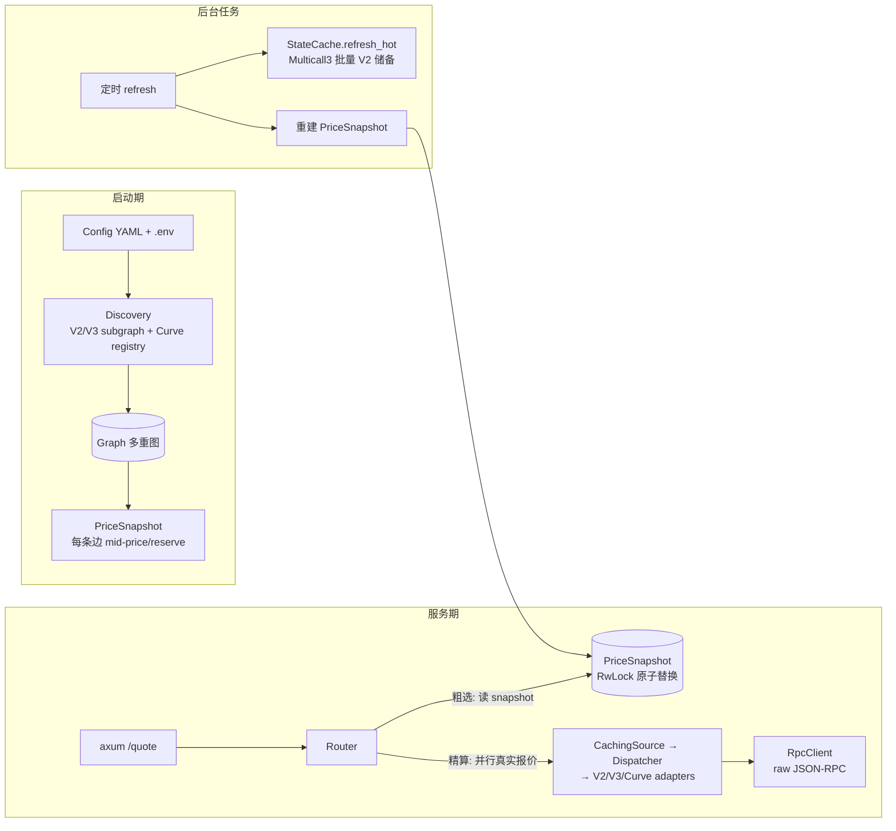
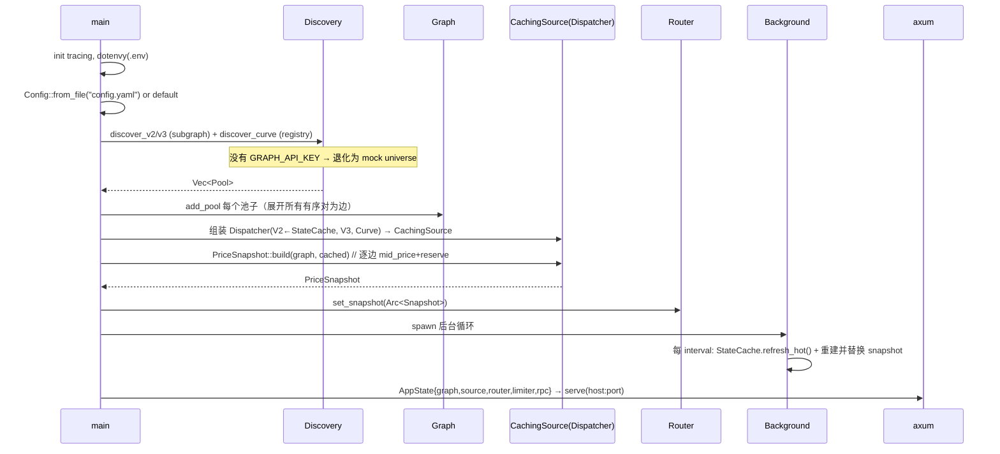

# Fluxion 架构设计文档

[English](ARCHITECTURE.en.md) | 中文

> 本文讲清楚 Fluxion **怎么运转**：从启动、发现池子、构建多重图、预热价格快照，到处理
> 一次 `/quote` 请求的完整数据流，以及缓存/RPC/并发的组织方式。
>
> 逐函数调用栈见 [`REQUEST-TRACE.md`](REQUEST-TRACE.md)。
>
> 面向：想读懂或修改本项目的人。代码即真相（`src/`），本文是导航图。

---

## 1. 一句话概括

Fluxion 是一个 **Ethereum 主网多跳路由询价服务**：给定 `token_in/token_out/amount_in`，
在 Uniswap V2/V3/Curve 构成的**有向多重图**上找到**单条最优路径**，返回精确
`amount_out`（exact-in）。它是**开源、自托管**的：一份 YAML 配置 + 你自己的 RPC/Graph key。

核心思想——**两层定价**：
- **粗选（coarse）**：用**内存里的价格快照**（mid-price）做快速图搜索，**零 RPC**。
- **精算（refine）**：只对少量候选路径，实时调用链上真实报价（含滑点、手续费），取最大。

---

## 2. 术语

| 术语 | 含义 |
|---|---|
| Token | ERC-20 代币（`Address` 唯一标识） |
| Pool / 池子 | 一个链上流动性池；`coins: Vec<Address>`，可含 2~4 个币 |
| PoolKind | 平台类型：`UniswapV2 / UniswapV3{fee} / Curve` |
| Edge / 边 | **有向**：某池子内「卖出币索引 i → 买入币索引 j」 |
| 多重图 | 同一对 token 在多平台/多池 = 多条**平行边** |
| mid-price | 零滑点瞬时价格（V2=储备比、V3=slot0、Curve=小额 dy/dx） |
| exact-in | 给定输入金额，求最大输出 |
| coarse / refine | 粗选（图搜索）/ 精算（链上真实报价） |
| snapshot | 每条边的 (mid_price, reserve) 预计算快照，提供给粗选 |
| hop | 路径上的一跳（一条边） |

---

## 3. 组件总览



模块与职责：

| 模块 | 职责 |
|---|---|
| `config.rs` | 读 YAML 配置 + 默认值 |
| `main.rs` | 启动编排：发现 → 建图 → 建快照 → 起后台 → 起服务 |
| `discovery.rs` | 从 subgraph（V2/V3）+ Curve 注册表发现池子并过滤 |
| `model.rs` | 领域类型（Token/Pool/Edge/Hop/Route/QuoteRequest） |
| `graph.rs` | 多重图：邻接表、平行边、多币池展开 |
| `source.rs` | `QuoteSource` trait（报价接口）+ mock 实现 |
| `adapters.rs` | 真实适配器 V2/V3/Curve + `Dispatcher` + `CachingSource` |
| `state.rs` | `StateCache`：V2 储备 TTL 缓存 + Multicall3 批量刷新 |
| `rpc.rs` | 原始 JSON-RPC 客户端（`eth_call`/`eth_blockNumber` + 重试） |
| `router.rs` | 快照 + K-best DP 粗选 + 并行精算 + price impact |
| `api.rs` | axum 路由、DTO、错误映射、限流、`/health`、`/ready` |
| `util.rs` | ABI 编码、hex、数值转换 |

---

## 4. 运行时生命周期



要点：
- **启动是同步阻塞发现 + 快照构建**（冷启动几秒到十几秒，取决于池子数与 RPC）。
- 后台**定时**（`refresh_interval_secs`，默认 30s）刷新两点：V2 储备（Multicall3 批量）
  与整个价格快照（保证粗选价格不陈旧）。

---

## 5. 数据模型（`model.rs`）

```rust
struct Token { address: Address, symbol: String, decimals: u8 }

enum PoolKind { UniswapV2, UniswapV3 { fee: u32 }, Curve }

struct Pool { kind: PoolKind, address: Address, coins: Vec<Address> }

struct Edge { pool_idx: usize, i: usize, j: usize }   // 池子 + 卖出币索引 i + 买入币索引 j

struct Hop { pool: Pool, i, j, token_in, token_out, amount_in: U256, amount_out: U256 }

struct Route { hops: Vec<Hop>, amount_out: U256, price_impact_bps: i64 }
```

金额一律 `U256`（十进制字符串进出 API）。各 token 的 `decimals` 不参与链式计算——报价函数
直接吃原始最小单位，逐跳把上一跳 `amount_out` 作为下一跳 `amount_in`。

---

## 6. 多重图（`graph.rs`）

```rust
struct Graph {
  tokens: HashMap<Address, usize>,   // token -> 节点 id
  token_addrs: Vec<Address>,         // id -> token
  pools: Vec<Pool>,
  edges: Vec<Edge>,
  out_edges: HashMap<usize, Vec<usize>>, // 节点 id -> 出边索引
}
```

**建图**（`add_pool`）：
- 把池子的每个币登记成节点；
- 对 `coins` 生成**所有有序对 (i,j), i≠j** 作为边。所以：
  - V2/V3（2 币）→ 2 条有向边；
  - Curve 3pool（3 币）→ 6 条；4 币 → 12 条。
- 同一 token 对来自不同池子/平台 → 天然是**平行边**（多重图）。

**为什么自定义邻接表**：边权是随请求变化的（含 amount 相关惩罚），且需要完整控制平行边与
方向，petgraph 反而碍事。查询走 `out_edge_indices(token)` → 出边列表。

---

## 7. 池子发现与过滤（`discovery.rs`）

三类来源并行/串行收集，最后 `Vec<Pool>` 汇总：

| 平台 | 来源 | 排序/过滤 |
|---|---|---|
| Uniswap V2 | The Graph V2 subgraph（分页 200/页） | `reserveUSD_gt`，另可 `volumeUSD_gt`、`createdAtTimestamp_lt` |
| Uniswap V3 | The Graph V3 subgraph（分页） | **按 `volumeUSD` 排序**（按 TVL 会冒出垃圾池），`totalValueLockedUSD_gt` 等 |
| Curve | 主 stableswap 注册表：`AddressProvider.get_registry()` → `pool_count/pool_list` → `coins(i)` | 每个池用一次 `get_dy` 探测"可报"，且所有币在白名单 |

**过滤策略**
- **默认主流币白名单**（内置 ~14 个：WETH/WBTC/USDC/USDT/DAI/USDS/stETH/wstETH/LINK/UNI/
  AAVE/MKR/CRV/LDO）。V2/V3 要求池子**两币**都在白名单；Curve 要求**所有币**都在。
  白名单可用配置 `token_allowlist` 覆盖。
- 阈值：`min_liquidity`、`min_volume_24h`（用 subgraph `volumeUSD` 作代理）、
  `min_pool_age_days`。
- `max_pools`：每平台上限，控制图规模与 RPC 压力。
- `enabled_platforms`：只发现启用的平台。

> 为什么要白名单：subgraph 的 TVL/volume 可被刷，垃圾/虚假池的 mid-price 会污染路由；
> 白名单把图收窄到可信主流币，既提质量又降 RPC。

---

## 8. 报价源与适配器（`source.rs` + `adapters.rs`）

### 统一接口

```rust
#[async_trait]
trait QuoteSource {
  async fn amount_out(&self, pool, i, j, amount_in) -> Result<U256>; // 真实精确报价（含滑点/费）
  async fn mid_price(&self, pool, i, j) -> Result<f64>;              // 零滑点瞬时价（给粗选）
  async fn reserve_in(&self, pool, i) -> Result<U256>;               // 输入侧储备（给惩罚/浅池判断）
}
```

### 三个真实适配器

- **UniswapV2**（`eth_call getReserves` → 常数积）：
  `amount_out = in*997*r_out/(r_in*1000 + in*997)`；`mid_price = r_out/r_in`；`reserve_in = r[i]`。
  储备来自 `StateCache`（见 §9）。
- **UniswapV3**（`QuoterV2.quoteExactInputSingle`，selector `0xc6a5026a`）：
  `amount_out` 由 QuoterV2 精确模拟（处理 fee/跨 tick）；`mid_price` 从 `slot0` 的
  `sqrtPriceX96` 换算 `(sqrt/2^96)^2`；`reserve_in = U256::MAX`（无传统储备）。
- **Curve**：先试 `get_dy(int128,...)`（`0x5e0d443f`），失败回退 `get_dy(uint256,...)`
  （`0x556d6e9f`，crypto 池）；`mid_price` 用小额 `dy/dx` 近似；`reserve_in = U256::MAX`。

### Dispatcher

按 `pool.kind` 把调用分派到对应适配器（V2 必有；V3/Curve 可选）。Dispatcher 本身也实现
`QuoteSource`，所以对上层是"一个源"。

### CachingSource

包在 Dispatcher 外，按 `(pool,i,j)` 缓存 `mid_price`、按 `(pool,i)` 缓存 `reserve_in`（TTL）。
主要用于 **PriceSnapshot 重建**时避免在 TTL 内重复打 RPC。注意：**`amount_out` 不缓存**
（依赖 amount，实时算）。

---

## 9. 三层缓存/状态（关键，容易混淆）

| 层 | 位置 | 缓存内容 | 谁用 | 作用 |
|---|---|---|---|---|
| **StateCache** | `state.rs` | V2 每个池的储备 `[U256;2]`，TTL | `UniswapV2` 适配器 | V2 储备缓存 + Multicall3 批量刷新 |
| **CachingSource** | `adapters.rs` | `mid_price`(pool,i,j) / `reserve_in`(pool,i)，TTL | `PriceSnapshot::build` | 重建快照时的二级缓冲 |
| **PriceSnapshot** | `router.rs` | 每条边的 `(mid_price, reserve_in)` 数组 | `Router` 粗选 | 粗选同步读，**零 RPC** |

数据流：
```
冷启动/后台刷新：PriceSnapshot::build
  → 逐边调用 CachingSource.mid_price/reserve_in
     → (未命中) Dispatcher → 适配器
        → V2: StateCache.get_reserves (命中则零 RPC；否则 Multicall/单次 getReserves)
        → V3: slot0 ; Curve: get_dy
  → 得到 per-edge mid_price/reserve → 存成一个不可变 PriceSnapshot

请求粗选：直接读 PriceSnapshot.per_edge[idx]（同步，微秒级）
请求精算：source.amount_out(...)（CachingSource→Dispatcher→适配器）
        → V2: StateCache 储备（≤TTL 旧）; V3: QuoterV2 实时; Curve: get_dy 实时
```

> 注意新鲜度差异：精算里 **V2 用的是 ≤TTL 的缓存储备**，而 **V3/Curve 是实时**。
> 这是已知问题（见 §15）。

---

## 10. 路由算法（`router.rs`）

### 10.1 粗选：把价格变成边权

对每条边 `e` 计算代价（越小越优）：

```
w(e) = -ln(mid_price) + fee_penalty(kind) + λ·(amount_in / reserve_in)
```

- `-ln(mid_price)`：最大化 `∏rate` ⟺ 最小化 `∑ -ln(rate)`；**可为负**（rate>1）。
- `fee_penalty`：近似每跳手续费（V2 0.3%，V3 `fee/1e6`，Curve ~4bp），让多跳别只靠 mid-price 赢。
- `λ·amount/reserve`：流动性惩罚（默认 λ=0 关）。
- `reserve_ratio_k > 0` 时：若 `reserve_in < k·amount_in`，该边置 `∞`（**浅池跳过**）。
  注意 V3/Curve `reserve_in=MAX`，故此规则**只对 V2 生效**。
- `mid_price` 非有限（链上读取失败/垃圾池）→ `∞`（跳过该边）。

### 10.2 K-best DP（限 hop、简单路径）

- `prev: HashMap<token, Vec<Candidate>>`，`Candidate{cost, edges, visited}`。
- 每轮扩展一跳；**禁止重复访问 token**（简单路径，避免负权自循环）。
- 每个 `(token, hop)` 只保留 **top_k** 条最低代价候选。
- 收集每一跳到达 `token_out` 的候选。

### 10.3 直连兜底

粗选可能因 mid-price 启发式把明显最优的**直连池**挤出 top-k。因此**额外把所有直连边
（`token_in→token_out` 的单边）加入候选**，确保精算能比较到它们。

### 10.4 精算（并发）

- 对所有候选路径**并发**（`futures::join_all`）逐跳链式调用 `amount_out`：
  `out1 = amount_out(e1, in)`，`out2 = amount_out(e2, out1)` …
- 取 `amount_out` 最大的路径。
- 计算 `price_impact_bps`：`round((1 - 实际均价 / mid-price连乘) * 10000)`。
- `amount_out_min` 校验（不足 → `AmountOutBelowMin`）。

### 10.5 为什么不用 Dijkstra

`-ln(rate)` 可为负，Dijkstra 要求非负权。这里用**限 hop 的松弛/DP + 简单路径**处理。

```mermaid
flowchart TD
  Req[QuoteRequest] --> Early{token_in==token_out? / amount=0?}
  Early -->|是| Ret0[直接返回/报错]
  Early -->|否| Snap[取 PriceSnapshot]
  Snap --> W[算边权<br/>-ln(mid)+fee+λ/浅池]
  W --> DP[K-best DP 限 hop 简单路径]
  DP --> Cand[候选路径]
  Cand --> Direct[加入直连边候选]
  Direct --> Refine[并发精算 amount_out]
  Refine --> Best[取最大 amount_out]
  Best --> Impact[算 price_impact_bps + amount_out_min 校验]
  Impact --> Res[Route]
```

---

## 11. RPC 层（`rpc.rs`）

- **原始 JSON-RPC via `reqwest`**（不用完整 alloy provider；仅用 `alloy-primitives` 的
  `U256/Address`）。
- `eth_call(to, data)`：自动补 `0x` 前缀；返回原始 bytes（调用方自行解码）。
- `block_number()`：给 `/ready` 探活。
- **重试**：3 次，遇 429 / "rate"/"too many" / 网络错误 → 退避 100/200/300ms。
- 所有 ABI 编码/解码在 `util.rs` + 各适配器手写（`pad_address`、`u256_word`、`u32_word`、
  `hex_decode`、`decode_reserves`、Multicall3 的 `encode/decode_aggregate3`）。

---

## 12. HTTP API（`api.rs`）

`AppState { graph, source: Arc<dyn QuoteSource>, router, limiter, rpc: Option<RpcClient> }`，
整体 `Arc` 共享给 axum。

### `POST /quote`

请求 `QuoteRequestDto`：`token_in, token_out, amount_in(字符串), max_hops?, amount_out_min?`
→ 解析成 `QuoteRequest` → `router.route(...)` → `QuoteResponseDto`：

```json
{ "amount_out": "...", "price_impact_bps": 32,
  "path": [{ "platform":"uniswap-v3","pool":"0x..","i":1,"j":0,
             "token_in":"0x..","token_out":"0x..","amount_in":"..","amount_out":".." }] }
```

错误映射（`ApiError`）：

| QuoteError | HTTP |
|---|---|
| `NoPath` (NoPathFound) | 404 |
| `UnknownPool` (PoolNotFound) | 404 |
| `AmountOutBelowMin` / `InsufficientLiquidity` / `Overflow` | 422 |
| `ZeroAmount` | 400 |
| `RpcError` | 502 |
| 参数解析失败 | 400 |
| 限流 | 429 |

### `GET /health` / `GET /ready`

- `/health`：进程存活。
- `/ready`：`Option<RpcClient>` 有值时做一次 `eth_blockNumber`（3s 超时），失败 503；无 RPC 时视为就绪。

### 限流

`RateLimiter`：全局窗口（默认 1000 请求/秒），内存计数。非按 IP、非分布式（自托管够用）。

---

## 13. 配置

- **`.env`（gitignored）**：**只放 `GRAPH_API_KEY`**。
- **`config.yaml`（由 `config.example.yaml` 复制）**：所有其他设置；缺省用 `config.rs` 默认值。
- 关键项：`host/port`、`rpc_url`、V2/V3 subgraph ID、`curve_address_provider`、
  `enabled_platforms`、`max_hops/top_k/max_pools`、`min_liquidity/min_volume_24h/min_pool_age_days`、
  `reserve_ratio_k`、`slippage_penalty_lambda`、`refresh_interval_secs`、`request_timeout_ms`、`token_allowlist`。

---

## 14. 一次请求的完整示例（WETH → USDC，1 WETH）

1. `POST /quote` → 解析 DTO → `QuoteRequest{token_in:WETH, token_out:USDC, amount_in:1e18}`。
2. Router 读取已安装的 `PriceSnapshot`（启动/后台构建好）。
3. **粗选（~0ms，纯内存）**：对图中每条边算权；V3 的 USDC/WETH 0.05% 池、V2 USDC/WETH 池、
   以及若干 2 跳路径都进入候选；直连池强制纳入。
4. **精算（~数百 ms，并行 live）**：对候选并发调用
   - V3 → `QuoterV2.quoteExactInputSingle`（实时）
   - V2 → `StateCache` 储备 + 常数积（可能 ≤TTL）
   - Curve → `get_dy`（实时）
   取 `amount_out` 最大者（通常 V3 0.05% 池胜出）。
5. 计算 `price_impact_bps`、校验 `amount_out_min`，返回 `Route` → DTO。

实测（公共 `eth.drpc.org`）：**总延迟 ~0.8s**，其中粗选 ~0ms、精算 ~0.8s（被最慢的一次
live 报价拖住）。返回示例：`2331667580`（≈2331.67 USDC，price impact ~5bps）。

---

## 15. 并发模型与锁

- tokio 多线程运行时；`AppState` 用 `Arc` 共享。
- 缓存用 `std::sync::Mutex`（`StateCache`、`CachingSource`）——**临界区极短且不在持锁时
  `await`**（都是「先加锁查 → 放锁 → await → 再加锁写」）。
- `PriceSnapshot` 用 `std::sync::RwLock<Option<Arc<PriceSnapshot>>>`：读时克隆 `Arc`（放锁），
  写时整体替换。快照是不可变的，读侧无竞争。
- 快照构建 `buffer_unordered(16)`（有界并发，避免 RPC 429）；精算 `join_all`（候选间并发）。

---

## 16. 失败与降级

- 无 `GRAPH_API_KEY` 或发现为空 → **退化为 mock universe**（内置 3 个假池，便于离线开发）。
- 单个平台发现失败 → 只 warn，继续其它平台。
- 单条边的 `mid_price`/`reserve_in` 失败 → 该边权 `∞`（跳过），**不影响整次询价**。
- 单条候选的 `amount_out` 失败 → 该候选被丢弃。
- RPC 429/瞬时错误 → 自动重试退避。

---

## 17. 已知限制 / 待改进

1. **延迟 ~0.8s、受公共 RPC 波动**：瓶颈在精算（最慢一次 live 报价）。
2. **新鲜度不一致**：精算时 V2 用 ≤TTL 的缓存储备，V3/Curve 实时。
3. **Curve 覆盖**：适配器支持 stableswap(int128) 与 crypto(uint256) 的 `get_dy`，但**自动发现**
   只覆盖主 stableswap 注册表；crypto/factory/metapool 注册表枚举未做；metapool 的
   `get_dy_underlying` 未用；原生 ETH 池不支持。
4. **粗选是启发式**：top-k 之外的真最优可能被漏（直连兜底缓解）；`price_impact_bps` 为近似。
5. **浅池保护只对 V2**（V3/Curve 的 reserve_in=MAX）。
6. **无单请求超时**；**无 metrics/优雅关闭**；限流是全局内存窗口。
7. **手写 ABI 编解码**：透明但易错；selector/地址分散，缺统一常量表。

---

## 18. 关键常量

| 用途 | 值 |
|---|---|
| `getReserves()` | `0x0902f1ac` |
| V3 `slot0()` | `0x3850c7bd` |
| QuoterV2 `quoteExactInputSingle` | `0xc6a5026a` @ `0x61fFE014bA17989E743c5F6cB21bF9697530B21e` |
| Curve `get_dy(int128,int128,uint256)` | `0x5e0d443f` |
| Curve `get_dy(uint256,uint256,uint256)` | `0x556d6e9f` |
| Curve AddressProvider | `0x0000000022D53366457F9d5E68Ec105046FC4383` |
| `get_registry()` / `pool_count()` / `pool_list(uint256)` / `coins(uint256)` | `0xa262904b` / `0x956aae3a` / `0x3a1d5d8e` / `0xc6610657` |
| Multicall3 / `aggregate3` | `0xcA11bde05977b3631167028862bE2a173976CA11` / `0x82ad56cb` |
| V2 subgraph ID | `EYCKATKGBKLWvSfwvBjzfCBmGwYNdVkduYXVivCsLRFu` |
| V3 subgraph ID | `5zvR82QoaXYFyDEKLZ9t6v9adgnptxYpKpSbxtgVENFV` |

---

## 19. 测试策略

- `cargo test`：单元（graph 展开、路由择优/简单路径、编码稳定性、配置解析、mock 适配器）。
- `cargo test -- --ignored`：真实主网集成（只读）——V2/V3/Curve 报价、V2 vs V3 择优、
  Curve 3pool、tricrypto2 crypto 池、Multicall3 热刷新、subgraph 发现、端到端多跳。
- V2 适配器另有**固定区块 `getReserves` fixture** 做不联网的确定性测试。

---

## 20. 关键文件速查

| 想看什么 | 去哪 |
|---|---|
| 启动编排、后台刷新 | `src/main.rs` |
| 路由/快照/边权 | `src/router.rs` |
| 适配器/Dispatcher/缓存 | `src/adapters.rs` |
| V2 储备 + Multicall3 | `src/state.rs` |
| 发现与过滤 | `src/discovery.rs` |
| HTTP/错误/限流 | `src/api.rs` |
| JSON-RPC/重试 | `src/rpc.rs` |
| 多重图 | `src/graph.rs` |
| 领域类型 | `src/model.rs` |
| ABI 编码 | `src/util.rs` |
