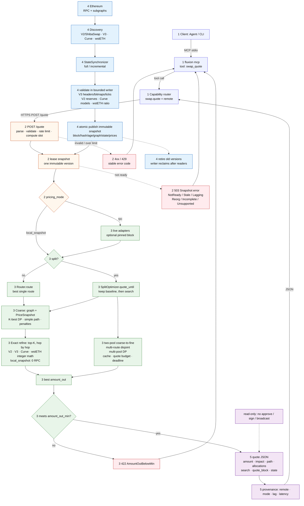

# swap.quote — end-to-end technical flow

English · [中文](ARCHITECTURE.zh.md)

This page is the detailed view of `swap.quote`: how a request enters Fluxion, how the remote quote
engine computes an exact-in amount, and how the background state pipeline keeps pricing data fresh.

The diagram is one vertical technical map with five colored phases. Follow the solid request arrows
from top to bottom; the background pipeline publishes the snapshot that the request leases. Dotted
arrows are error, retirement or read-only notes.

### Reading the diagram

| Color | Phase | What it answers |
|---|---|---|
| Indigo | 1. Client | How does an agent reach Fluxion? |
| Orange | 2. API | What is validated, limited and leased before compute? |
| Green | 3. Engine | How is the route searched and split? |
| Blue | 4. Background | How is the immutable pricing snapshot built and published? |
| Purple | 5. Response | What does the caller receive? |
| Red | Errors | Where do stable error codes come from? |

Solid arrows are request/control flow. Dotted arrows are asynchronous state, retirement or
read-only notes.

## 1. Client and transport

| Step | Detail |
|---|---|
| Agent entry | An agent calls the MCP tool `swap_quote`; the CLI uses `fluxion swap ...`. |
| MCP tool | `fluxion mcp` is a stdio bridge. The tool arguments are `token_in`, `token_out`, `amount`, `max_hops`, `split`, `split_max_branches`, `decimals_in`, `decimals_out`. |
| Capability routing | `swap.quote` is fixed to the remote service. The agent does not choose local/remote and does not send a provider or mode. |
| Transport | The client sends `POST /quote`. Authentication, installation tokens and MCP registration are transport concerns: [docs/MCP.md](../../MCP.md). |

## 2. Remote API and admission

| Step | Detail |
|---|---|
| Parse | `token_in` / `token_out` are Ethereum addresses; `amount_in` is a raw `U256` string. |
| Validate | `split_max_branches` is only valid with `split=true`; zero amount is rejected; branch limits are checked against the configured maximum. |
| Rate limit | The in-process limiter rejects over-budget requests with `429 RateLimited`. |
| Compute slot | Local-snapshot quotes acquire one of `compute_concurrency` slots. A saturated slot returns `429` rather than queueing without bound. |
| Snapshot lease | `SnapshotStore::acquire()` returns one immutable `LocalSnapshot`. Ready, age, lag, reorg and completeness checks happen before any quote math. |
| State errors | A missing, stale, lagging, reorged, incomplete or unsupported snapshot returns `503` with a state error. There is no request-time RPC fallback. |
| Deadline | The service reserves a small response margin inside `request_timeout`; the engine gets a deadline slightly earlier than the HTTP timeout. |

## 3. Pricing modes

| Mode | Behavior |
|---|---|
| `local_snapshot` | Default production mode. All quote math reads the leased snapshot's frozen pool state. The quote path performs **0 RPC**. |
| `rpc` | Legacy comparison mode. The same Router/SplitOptimizer calls live adapters. Split search may pin one block; otherwise the source is the server's cached/RPC source. |

The router algorithm is shared by both modes. Only the `QuoteSource` implementation changes.

## 4. Route search

| Stage | Detail |
|---|---|
| Graph | Tokens are nodes; pools are directed edges. Parallel pools remain parallel edges. A multi-coin pool is expanded into every ordered pair. |
| Coarse snapshot | `PriceSnapshot` stores `mid_price` and `reserve_in` per edge, so path search does not call RPC. |
| Coarse ranking | Weight is `-ln(mid_price) + fee_penalty + optional liquidity_penalty`. The reserve-ratio filter can remove pools too shallow for the requested amount. |
| K-best DP | Up to `max_hops`, with a simple-path constraint (no repeated token) and bounded diversity per venue family. Direct pools are added explicitly so a cheap-looking multi-hop route cannot hide the obvious route. |
| Exact refine | Top-K candidates are re-quoted hop by hop with protocol integer math. The best exact `amount_out` wins, not the best mid-price. |
| Price impact | `price_impact_bps` compares the executable rate with the route's product of mid-prices. |

## 5. Split search

The single-route result is always retained as the baseline. Split search can only replace it with a
strictly better exact output.

| Stage | Detail |
|---|---|
| Baseline | `Router.route` produces the best single route and seeds the result. |
| Two-pool allocation | Evaluate direct pools on a coarse input grid, then refine around the best split point. `coarse_segments` and `refinement_segments` control the grid. |
| Multi-route | Select up to `max_branches` routes that share no pool, then allocate across those branches. |
| Route tree | When paths share a first hop, allocate across first-hop groups and let each intermediate token fan out to multiple suffix pools. Nested DP keeps shared-prefix pools counted once; suffix branches are returned as allocation `children`. |
| Multi-pool | Sample per-pool quote tables over `allocation_segments`, solve a discrete DP, then re-quote integer remainders. |
| Budgets | `max_quote_calls`, `max_pools`, `concurrency`, `timeout_ms` and the request deadline bound the search. |
| Caching | A request-local cache prevents repeating the same `(pool, i, j, amount)` quote. |
| Stop reasons | `Completed`, `NoPairs`, `QuoteBudget`, `TimeBudget`. A budget stop keeps the best completed plan. |
| Result | `plan_kind` is `baseline`, `direct` or `split`; `allocations` contains exact per-branch inputs, outputs and hops. |

For the detailed comparison of full/incremental state, event-driven dirty sets, graph updates and
the future multi-chain design, see [GRAPH-AND-SNAPSHOT.md](GRAPH-AND-SNAPSHOT.md).

## 6. Background state pipeline

| Stage | Detail |
|---|---|
| Discovery | Builds the token/pool graph from the configured V2/ShibaSwap, V3-compatible deployments (Uniswap/Sushi/Pancake), Curve and wstETH universe. |
| Synchronizer | `StateSynchronizer` is the only component that owns an RPC client. It polls the canonical head and loads state. |
| Full mode | Rebuilds all pool state at the target block. Reorgs and missing data fall back to a full rebuild. |
| Incremental mode | Reads structural logs, updates V3 initialized ticks, refreshes V3 market fields, and reloads platforms that need full state. Gaps, reorgs or incomplete data force a full rebuild. |
| Validation | V3 headers, bitmap words and initialized ticks; V2 reserves; supported Curve deployment models; wstETH protocol ratio. Unsupported pools remain visible and block a complete snapshot. |
| Publish | A complete snapshot is published atomically under a short lock. It contains block number/hash, timestamp, graph, frozen pool state and coarse prices. |
| Readers | In-flight requests keep their old snapshot. The writer reclaims retired snapshots only after readers release them. |
| Freshness | Age, lag and reorg are explicit. A quote never silently drops an unsupported pool to look successful. |

## 7. Response

| Field | Meaning |
|---|---|
| `amount_out` | Exact raw output amount. |
| `price_impact_bps` | Executable rate versus mid-price, in basis points. |
| `path` | Per-hop platform, pool, token pair and amounts. |
| `plan_kind` | `baseline`, `direct` or `split`. |
| `allocations` | Exact inputs, outputs and hops per split branch. |
| `baseline_amount_out` | Single-route baseline retained for comparison. |
| `search` | Quote calls, cache hits, candidate counts, stop reason and timing. |
| `quote_block` | Snapshot block used for the quote. |
| `state` | Pricing mode, block hash, state age and lag. |
| Provenance | Client-level `execution=remote`, `pricing_mode`, `block_hash`, `state_age_secs`, `lag_blocks`, `latency_ms`. |

## 8. Error map

| HTTP | Code | Cause |
|---:|---|---|
| 400 | `InvalidRequest` / `ZeroAmount` | Bad address, amount or argument combination. |
| 404 | `NoPathFound` / `PoolNotFound` | No graph path or unknown/local pool state. |
| 422 | `AmountOutBelowMin` | Result is below the caller's minimum. |
| 422 | `InsufficientLiquidity` / `Overflow` | Pool math cannot produce a valid output. |
| 429 | `RateLimited` | Rate limit or all compute slots are busy. |
| 502 | `RpcError` | RPC failure in `rpc` mode. |
| 503 | `Snapshot*` | Not ready, stale, lagging, reorged, incomplete or unsupported. |
| 504 | `Timeout` | Request deadline exceeded. |
| 500 | `ComputationFailed` | Unexpected worker failure. |

## 9. Invariants

- `swap.quote` is read-only: it never approves, signs or broadcasts.
- Execution is fixed to remote; there is no local/remote selector and no cross-location fallback.
- One request uses one snapshot version.
- Local-snapshot quote computation performs zero RPC.
- Amounts use protocol integer rounding; no floating-point amount math.
- Incomplete coverage is an error, not a reason to silently reduce the pool universe.
- A split plan only replaces the baseline when its exact output is strictly better.
