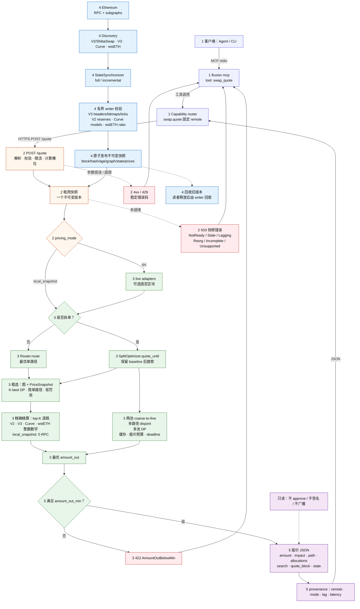

# swap.quote — 端到端技术流程

[English](ARCHITECTURE.md) · 中文

本页详细说明 `swap.quote`：一个请求如何进入 Fluxion，远程报价引擎如何计算 exact-in 金额，
以及后台状态流水线如何保持价格数据新鲜。

下图是一张纵向技术地图，分成 5 个颜色分区。沿着实线请求箭头从上往下读；后台流水线负责发布
请求所租用的快照。虚线表示错误、旧版本回收或只读说明。

### 如何读这张图

| 颜色 | 阶段 | 回答的问题 |
|---|---|---|
| 靛蓝 | 1. 客户端 | Agent 如何进入 Fluxion？ |
| 橙色 | 2. API | 计算前校验、限流和租用快照做了什么？ |
| 绿色 | 3. 引擎 | 路由如何搜索和拆单？ |
| 蓝色 | 4. 后台 | 不可变价格快照如何构建和发布？ |
| 紫色 | 5. 响应 | 调用方最终拿到什么？ |
| 红色 | 错误 | 稳定错误码从哪里来？ |

实线是请求/控制流。虚线是异步状态、旧版本回收或只读说明。

## 1. 客户端与传输

| 步骤 | 细节 |
|---|---|
| Agent 入口 | Agent 调用 MCP tool `swap_quote`；CLI 使用 `fluxion swap ...`。 |
| MCP tool | `fluxion mcp` 是 stdio bridge。参数包括 `token_in`、`token_out`、`amount`、`max_hops`、`split`、`split_max_branches`、`decimals_in`、`decimals_out`。 |
| Capability 路由 | `swap.quote` 固定使用 remote 服务。Agent 不选择 local/remote，也不发送 provider 或 mode。 |
| 传输 | 客户端发送 `POST /quote`。认证、安装 token 和 MCP 注册属于传输层：[docs/MCP.md](../../MCP.md)。 |

## 2. Remote API 与请求准入

| 步骤 | 细节 |
|---|---|
| 解析 | `token_in` / `token_out` 是 Ethereum 地址；`amount_in` 是原始 `U256` 字符串。 |
| 校验 | `split_max_branches` 只能和 `split=true` 一起使用；零金额会被拒绝；分支上限会和配置最大值比较。 |
| 限流 | 进程内 limiter 对超限请求返回 `429 RateLimited`。 |
| 计算槽位 | local-snapshot 报价会获取 `compute_concurrency` 个槽位之一。槽位耗尽返回 `429`，不会无界排队。 |
| 快照租约 | `SnapshotStore::acquire()` 返回一个不可变 `LocalSnapshot`。就绪、年龄、落后、reorg 和完整性检查都发生在任何报价计算之前。 |
| 状态错误 | 快照缺失、过期、落后、reorg、不完整或不支持时返回 `503` 状态错误。不存在请求时 RPC 回退。 |
| Deadline | 服务会在 `request_timeout` 内预留少量响应余量；引擎拿到的 deadline 略早于 HTTP 超时。 |

## 3. 定价模式

| 模式 | 行为 |
|---|---|
| `local_snapshot` | 默认生产模式。所有报价数学读取租用快照中的冻结池状态。报价路径 **0 RPC**。 |
| `rpc` | 旧版对照模式。同一个 Router/SplitOptimizer 调用 live adapters。拆单搜索可以固定一个区块；否则使用服务端缓存/RPC source。 |

两种模式共享 Router 算法，只替换 `QuoteSource` 实现。

## 4. 路由搜索

| 阶段 | 细节 |
|---|---|
| Graph | token 是节点，pool 是有向边。平行池保留平行边。多币池展开成所有有序币对。 |
| 粗选快照 | `PriceSnapshot` 为每条边保存 `mid_price` 和 `reserve_in`，路径搜索不需要 RPC。 |
| 粗选排序 | 权重是 `-ln(mid_price) + fee_penalty + 可选 liquidity_penalty`。reserve-ratio 过滤会排除相对请求金额过浅的池。 |
| K-best DP | 最多 `max_hops`，带 simple-path 约束（token 不重复）和每个 venue family 的多样性上限。直接池会显式加入，避免看似便宜的多跳路径挤掉明显的最优直达路径。 |
| 精确精算 | top-K 候选逐跳用协议整数数学重新报价。胜出的是最优 exact `amount_out`，不是最优中间价。 |
| 价格冲击 | `price_impact_bps` 用可执行汇率和路径中间价乘积比较。 |

## 5. 拆单搜索

单路径结果始终保留为 baseline。拆单搜索只能用严格更优的 exact 输出替换它。

| 阶段 | 细节 |
|---|---|
| Baseline | `Router.route` 产生最优单路径，作为结果种子。 |
| 两池分配 | 在粗粒度输入网格上评估直接池，然后围绕最优点细化。`coarse_segments` 和 `refinement_segments` 控制网格。 |
| 多路径 | 选择最多 `max_branches` 条互不共享池的路径，再在这些分支间分配。 |
| 路由树 | 路径共享首跳时，先在首跳分组间分配，再让每个中间 token 的产出分叉到多个后缀池。嵌套 DP 保证共享前缀只计一次；后缀分支通过 allocation 的 `children` 返回。 |
| 多池 | 在 `allocation_segments` 上采样每个池的报价表，解离散 DP，再重新报价整数余数。 |
| 预算 | `max_quote_calls`、`max_pools`、`concurrency`、`timeout_ms` 和请求 deadline 限制搜索。 |
| 缓存 | 请求级缓存避免重复计算同一个 `(pool, i, j, amount)`。 |
| 停止原因 | `Completed`、`NoPairs`、`QuoteBudget`、`TimeBudget`。预算停止时保留已完成的最优计划。 |
| 结果 | `plan_kind` 为 `baseline`、`direct` 或 `split`；`allocations` 包含每个分支的精确输入、输出和 hops。 |

关于 full/incremental、事件驱动 dirty set、Graph 更新和未来多链设计的详细对比，见
[GRAPH-AND-SNAPSHOT.zh.md](GRAPH-AND-SNAPSHOT.zh.md)。

## 6. 后台状态流水线

| 阶段 | 细节 |
|---|---|
| Discovery | 从配置的 V2/ShibaSwap、V3 兼容部署（Uniswap/Sushi/Pancake）、Curve 和 wstETH universe 构建 token/pool 图。 |
| Synchronizer | `StateSynchronizer` 是唯一持有 RPC client 的组件。它轮询 canonical head 并加载状态。 |
| Full 模式 | 在目标区块重建全部池状态。reorg 和缺失数据会回退到 full rebuild。 |
| Incremental 模式 | 读取结构日志，更新 V3 initialized ticks，刷新 V3 市场字段，并重新加载需要完整状态的平台。gap、reorg 或不完整数据会强制 full rebuild。 |
| 校验 | V3 headers、bitmap words、initialized ticks；V2 reserves；支持的 Curve 部署模型；wstETH 协议比例。Unsupported pool 保持可见，并阻止完整快照发布。 |
| 发布 | 完整快照在短锁内原子发布。包含 block number/hash、timestamp、graph、冻结池状态和粗选价格。 |
| 读者 | 在途请求继续持有旧快照。writer 只在读者释放后回收 retired snapshots。 |
| 新鲜度 | age、lag、reorg 都是显式错误。报价不会为了看起来成功而静默丢弃 unsupported pool。 |

## 7. 响应

| 字段 | 含义 |
|---|---|
| `amount_out` | 精确原始输出金额。 |
| `price_impact_bps` | 可执行汇率相对中间价，单位 bps。 |
| `path` | 每一跳的平台、池、token pair 和金额。 |
| `plan_kind` | `baseline`、`direct` 或 `split`。 |
| `allocations` | 每个拆单分支的精确输入、输出和 hops。 |
| `baseline_amount_out` | 保留用于比较的单路径 baseline。 |
| `search` | 报价调用数、缓存命中、候选数、停止原因和耗时。 |
| `quote_block` | 报价使用的快照区块。 |
| `state` | 定价模式、block hash、state age 和 lag。 |
| Provenance | 客户端级 `execution=remote`、`pricing_mode`、`block_hash`、`state_age_secs`、`lag_blocks`、`latency_ms`。 |

## 8. 错误映射

| HTTP | Code | 原因 |
|---:|---|---|
| 400 | `InvalidRequest` / `ZeroAmount` | 地址、金额或参数组合错误。 |
| 404 | `NoPathFound` / `PoolNotFound` | 图中没有路径，或池状态未知。 |
| 422 | `AmountOutBelowMin` | 结果低于调用方最低值。 |
| 422 | `InsufficientLiquidity` / `Overflow` | 池数学无法产生有效输出。 |
| 429 | `RateLimited` | 限流或所有计算槽位都在忙。 |
| 502 | `RpcError` | `rpc` 模式下的 RPC 失败。 |
| 503 | `Snapshot*` | 未就绪、过期、落后、reorg、不完整或不支持。 |
| 504 | `Timeout` | 请求 deadline 超时。 |
| 500 | `ComputationFailed` | worker 意外失败。 |

## 9. 不变量

- `swap.quote` 是只读的：不 approve、不签名、不广播。
- 执行位置固定为 remote；没有 local/remote 选择器，也没有跨执行位置回退。
- 一个请求只使用一个快照版本。
- local-snapshot 报价计算执行 0 RPC。
- 金额使用协议整数舍入；不使用浮点金额数学。
- 覆盖不完整是错误，不是静默缩小池子集合的理由。
- 拆单计划只有在 exact 输出严格更优时才替换 baseline。
