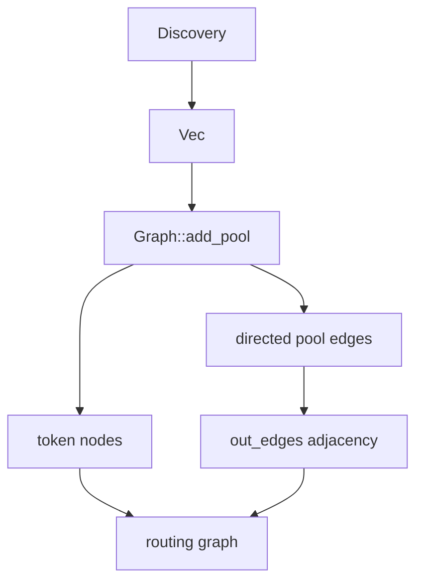
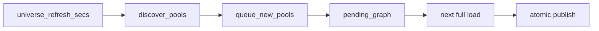
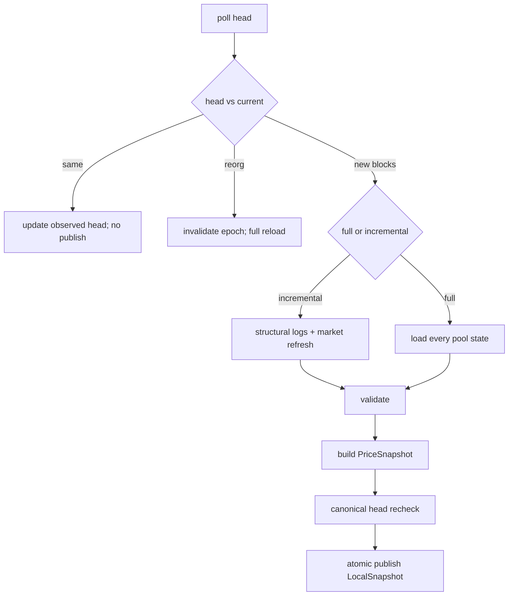
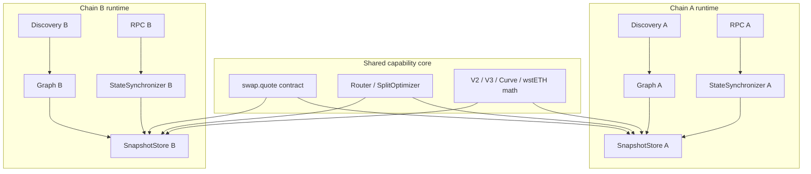

# swap.quote — graph and snapshot lifecycle

English · [中文](GRAPH-AND-SNAPSHOT.zh.md)

This document explains how `swap.quote` builds its routing graph, how the graph changes over time,
and how pool state is refreshed without mixing block heights or serving partial data.

It also compares alternative designs and describes the **future multi-chain target**. Multi-chain
is design-only here: the current implementation is single-chain Ethereum.

## 1. Scope and terminology

| Term | Meaning |
|---|---|
| Graph | Token nodes plus directed pool edges. |
| Pool | One AMM or conversion deployment. |
| Pair | A tradable token pair. A pair can have many pools. |
| Edge | One directed swap inside one pool: `i -> j`. |
| Topology | Which tokens, pools and edges exist. |
| State | Reserves, V3 ticks, Curve balances, wstETH ratio. |
| Snapshot | An immutable graph + state + coarse prices at one block. |
| Dirty pool | A pool whose state may have changed in the current block range. |

The important split is:

```text
Topology freshness: which pools and edges exist
State freshness:    reserves / ticks / prices at a block
```

They have different update frequencies and different failure modes.

## 2. Current implementation (single-chain)

### 2.1 Graph construction



Discovery assembles the pool list from:

- Uniswap V2 subgraph
- V3-compatible deployments: Uniswap, SushiSwap and PancakeSwap through
  `v3_deployments` (each has its own factory, quoter and subgraph/deployment id)
- Curve `AddressProvider` and registries
- ShibaSwap and configured V2 forks through `getPair`
- Configured protocol conversions such as wstETH

Then `Graph::add_pool` does the structural expansion:

```text
for each pool:
    register each coin as a token node
    for each allowed ordered pair (i, j):
        append Edge { pool_idx, i, j }
        out_edges[token_i].push(edge_idx)
```

Properties:

- Tokens are deduplicated by address.
- A two-coin pool creates two directed edges.
- A three-coin pool creates six directed edges.
- Parallel pools for the same pair remain parallel edges.
- Conversion edges are direction-specific (`wrap` / `unwrap`).
- The graph stores topology only. Reserves and ticks live in the snapshot.

Relevant code: `crates/remote/src/graph.rs`, `crates/remote/src/model.rs`,
`crates/remote/src/discovery.rs`, `crates/remote/src/universe.rs`.

### 2.2 Graph updates

Runtime topology refresh uses an **add-only pending graph**:



Rules:

- New pools are merged into a cloned graph.
- Pools are deduplicated by pool address.
- Unsupported pools are skipped and reported separately.
- The currently published graph is not modified.
- Request readers keep using their old snapshot.
- Only a complete load can publish the pending graph.
- A failed load never publishes the pending graph; the old graph remains. Incomplete or
  unsupported pending universes are discarded.

Current limitation:

```text
Add-only: pools are never removed by the runtime refresh.
```

Removing pools safely needs a quarantine or confirmation window so that a temporary discovery
failure cannot delete a healthy pool.

Relevant code: `crates/remote/src/main.rs` (`universe_refresh_secs`),
`crates/remote/src/local_state.rs` (`queue_new_pools`, `graph_for_sync`, `publish`).

### 2.3 Snapshot updates

`StateSynchronizer` is the only component that owns an RPC client. It polls the canonical head and
publishes immutable `LocalSnapshot` versions.



Current platform behavior:

| Platform | Structural events | Current refresh |
|---|---|---|
| V2 / ShibaSwap | None used | All pools re-read reserves. |
| V3 | `Mint`, `Burn`, `Initialize` | Affected ticks are updated; all V3 pools re-read `slot0` + `liquidity`. |
| Curve | None used | All Curve pools full reload. |
| wstETH | None used | All conversion links full reload. |

Important details:

- V3 structure is shared through `Arc<V3Structure>`.
- A V3 swap is not decoded. `slot0` and `liquidity` are re-read for every V3 pool.
- Structural logs identify affected V3 pools and ticks, but market fields are still global.
- `full_reload_interval_secs` periodically reconciles incremental updates.
- Large gaps, reorgs and incomplete loads force a full reload.
- A new block can fail to publish; the old snapshot remains, but its age continues to grow.
- Readers reject stale, lagging, reorged, incomplete or unsupported snapshots.

`LocalSnapshot` contains:

```text
block header
graph
FrozenSource (V2 reserves, V3 state, Curve state, wstETH state)
Router with coarse PriceSnapshot
epoch and publish time
```

It has no RPC handle. Quote computation is local and, in `local_snapshot` mode, performs zero RPC.

Relevant code: `crates/remote/src/local_state.rs`, `crates/remote/src/v3_sync.rs`,
`crates/remote/src/v3_local.rs`.

## 3. Design space

### 3.1 Graph construction options

| Option | Strengths | Weaknesses | Fit |
|---|---|---|---|
| Subgraph / indexer | Broad discovery, rich filters, cheap to query | Indexing lag, provider dependency, coverage gaps | Good for broad V2/V3 discovery |
| On-chain registry / factory | Authoritative, no indexer | Many calls, interface-specific, weak volume/age filters | Good for Curve, forks, verification |
| Static configured pools | Deterministic, curated | Manual, stale, does not scale | Good for tests and special pools |
| Pool-creation events | Real-time new pools | Requires complete log history, reorg handling, event decoding | Good complement, not sole source |
| Hybrid | Broad discovery plus authoritative checks | More code and reconciliation | Best current approach |

### 3.2 Graph topology update options

| Option | Strengths | Weaknesses |
|---|---|---|
| Periodic full rediscovery + replace | Removes stale pools; simple mental model | Expensive; discovery failure can cause churn |
| Add-only pending graph (current) | Safe for readers; no disappearing pools | Graph grows forever; no removals |
| Diff add/remove with quarantine | Accurate and bounded | Needs confirmation window, reorg handling, rollback |
| Pool-creation events + periodic reconcile | New pools appear quickly | Event coverage and backfill complexity |
| Streaming/indexer topology feed | Low latency, less polling | Operational dependency and consistency risk |

### 3.3 Snapshot state update options

| Option | Strengths | Weaknesses |
|---|---|---|
| Full reload every poll | Simplest correctness story | High RPC/CPU cost as pools grow |
| Current hybrid | Good balance; V3 structure is incremental | V2/Curve/wstETH still full; all V3 market fields refresh |
| Dirty set + exact refresh | Only touched pools are read; still exact at block hash | Needs reliable logs, backfill, reorg handling, event coverage |
| Per-pool subscriptions + event deltas | Lowest latency | Hard correctness; subscription scale; event order; missing events |
| External streaming/indexer state service | Scales across chains and pools | New infrastructure, latency and consistency design |
| Request-time lazy RPC | Always latest | High latency, rate limits, no block-consistent multi-hop quote |

### 3.4 Why not event-delta-only

Applying event payloads directly to state is tempting but fragile:

- Multiple swaps can touch one pool in one block.
- `Mint` / `Burn` / `Swap` events may interleave.
- A pool's final state is not always fully described by one event.
- Curve events do not always expose complete balances.
- Missing or duplicate logs corrupt the state silently.
- Reorg rewinds are harder than re-reading final state.

The safer rule is:

```text
Events select dirty pools.
Exact state reads decide the final state at the target block hash.
```

## 4. Recommended evolution

The recommended target is:

```text
event-driven dirty set
+ exact state refresh at block hash
+ immutable snapshot
+ periodic full reconciliation
+ per-chain sharding
```

This keeps the current correctness model while reducing unnecessary work.

### Phase 1: current baseline

- Single chain.
- Add-only topology updates.
- V3 structural incremental + all V3 market fields.
- V2/Curve/wstETH full refresh.
- Atomic snapshot publish and freshness gates.

### Phase 2: dirty-set state refresh

Add a per-platform state-topic set:

| Platform | State topics | Dirty action |
|---|---|---|
| V2 / ShibaSwap | `Swap`, `Sync`, `Mint`, `Burn` | Re-read reserves for dirty pools. |
| V3 | `Swap`, `Mint`, `Burn`, `Initialize` | Re-read `slot0`/`liquidity` for dirty pools; update affected ticks. |
| Curve | `TokenExchange`, `TokenExchangeUnderlying`, add/remove liquidity | Re-read state for dirty pools. |
| wstETH | No reliable pool event | Keep periodic/full refresh or add Lido-specific events. |

Then:

```text
block range logs
  → dirty pool set
  → exact multicall at block hash
  → merge with previous snapshot
  → publish
```

Keep periodic full reconciliation to catch missed events, unknown pool types and external state
changes.

### Phase 3: graph diff and scale

- Add/remove pools with quarantine and confirmation.
- Update `PriceSnapshot` incrementally for dirty edges instead of rebuilding every edge.
- Shard state workers by chain and platform.
- Add per-chain RPC pools and rate limits.
- Add candidate pruning and per-chain snapshot limits.

### Phase 4: multi-chain

Multi-chain is a data-model change, not just a config change.

## 5. Multi-chain target design

Multi-chain is **not implemented**. This section is the future design target.

### 5.1 Current single-chain assumptions

| Area | Current assumption |
|---|---|
| Config | One `rpc_url`, one subgraph set, one Curve provider. |
| Graph | Token and pool keys are `Address` only. |
| Pool | No `chain_id`. |
| Snapshot | One `SnapshotStore` and one `Graph` per server. |
| Request | `swap.quote` request has no chain field. |
| Response | `chain` is a string label; no chain id. |
| Client | `chain = "ethereum"` is hardcoded. |
| Finality | One `max_age_secs` / `max_lag_blocks` policy. |

These assumptions must change before adding a second chain.

### 5.2 Identity changes

Introduce chain-scoped identities:

```text
ChainId(u64)
AssetId { chain_id, address }
PoolId  { chain_id, address }
```

Graph nodes and edges must never allow the same `Address` on different chains to collide.

### 5.3 Per-chain runtime



Rules:

- One graph per chain. No cross-chain edges in the same graph.
- One snapshot store per chain.
- One synchronizer per chain, with its own RPC and freshness policy.
- Router and split logic are shared code, but operate on one chain's graph.
- `swap.quote` selects a chain explicitly; it does not silently mix chains.
- Cross-chain swaps are a separate capability, not a hidden route in `swap.quote`.

### 5.4 Chain configuration

```text
ChainConfig {
  chain_id,
  rpc_urls,
  subgraph_ids,
  curve_provider,
  enabled_platforms,
  finality / reorg policy,
  poll_interval,
  max_age_secs,
  max_lag_blocks,
  batch sizes
}
```

### 5.5 Freshness and finality

Per-chain policies are required:

- L1 and L2 have different block times and reorg depths.
- Some chains support safe/finalized tags; some RPCs do not.
- `max_age_secs` and `max_lag_blocks` must not be global constants.
- The response should expose `chain_id`, block number, block hash and finality metadata.
- Stale/lagging/reorg errors remain explicit per chain.

### 5.6 API and routing boundary

The request must identify the chain, for example:

```text
POST /quote  { chain_id, token_in, token_out, amount_in, ... }
```

or a chain-scoped route. The exact transport shape is a separate contract decision.

Rules:

- `swap.quote` routes within one chain.
- A token address without a chain is ambiguous once multiple chains exist.
- A quote response must carry `chain_id`.
- Cross-chain routing requires a bridge/execution capability and explicit user authorization.

## 6. Scale: more pools and pairs

### 6.1 What grows

- Multi-coin pools expand as `n * (n - 1)` edges.
- Parallel pools add parallel edges for the same pair.
- More pairs increase candidate search and exact-refine work.
- More chains multiply independent graphs and state pipelines.

### 6.2 Cost centers

| Cost | Current driver |
|---|---|
| RPC reads | All V3 market fields; V2/Curve/wstETH full refresh |
| Logs | V3 structural logs; future dirty-set topics |
| CPU | `PriceSnapshot` rebuild; K-best DP; split search |
| Memory | Graph edges; V3 structures; snapshots retained by readers |
| Discovery | Subgraph pages, factory pairs, Curve registry enumeration |

### 6.3 Scale levers

- Dirty-set state refresh.
- Incremental `PriceSnapshot` updates for dirty edges.
- Add/remove graph diffs with quarantine.
- Per-chain and per-platform workers.
- Candidate pruning, `max_hops`, `top_k`, family diversity and reserve filters.
- Batched multicall and log chunking.
- Snapshot refcount retirement and bounded old-version retention.
- Metrics for RPC cost, dirty-pool ratio, snapshot age, lag and full-reload duration.

## 7. Recommended target summary

```text
Topology:
  hybrid discovery
  + add/remove diffs
  + quarantine
  + periodic full reconcile
  + atomic pending graph

State:
  event-driven dirty set
  + exact state read at block hash
  + V3 structural ticks
  + periodic full reconcile
  + immutable snapshot publish
  + per-chain freshness gates

Multi-chain:
  chain-scoped AssetId / PoolId
  + one graph and snapshot store per chain
  + shared router / split / math
  + no cross-chain edges in swap.quote
```

The key principle is:

> **Events identify what may have changed; exact state reads decide what the snapshot contains.**

## 8. Open questions

- Do we need pool removal, or is restart/configuration enough for the next stage?
- Which chains are first after Ethereum, and what finality/reorg policy do they need?
- Should discovery use Substreams/Firehose, WebSocket logs, or HTTP log polling?
- Should multi-chain be exposed as a chain field on `/quote` or a chain-scoped endpoint?
- Do we need an external state/indexer service, or keep sync in-process per chain?
- Should `PriceSnapshot` be rebuilt or incrementally updated for dirty edges?
- How long should retired snapshots be retained for audit/debugging?

## 9. Code map

| Area | Code |
|---|---|
| Graph nodes, edges, adjacency | `crates/remote/src/graph.rs` |
| Pool and edge types | `crates/remote/src/model.rs` |
| Discovery sources and filters | `crates/remote/src/discovery.rs`, `universe.rs` |
| Pending graph and snapshot store | `crates/remote/src/local_state.rs` |
| Synchronizer and freshness gates | `crates/remote/src/local_state.rs` |
| V3 structural and market refresh | `crates/remote/src/v3_sync.rs`, `v3_local.rs` |
| HTTP admission and snapshot lease | `crates/remote/src/api.rs` |
| Startup and universe refresh | `crates/remote/src/main.rs` |
| Chain and platform configuration | `crates/remote/src/config.rs` |
