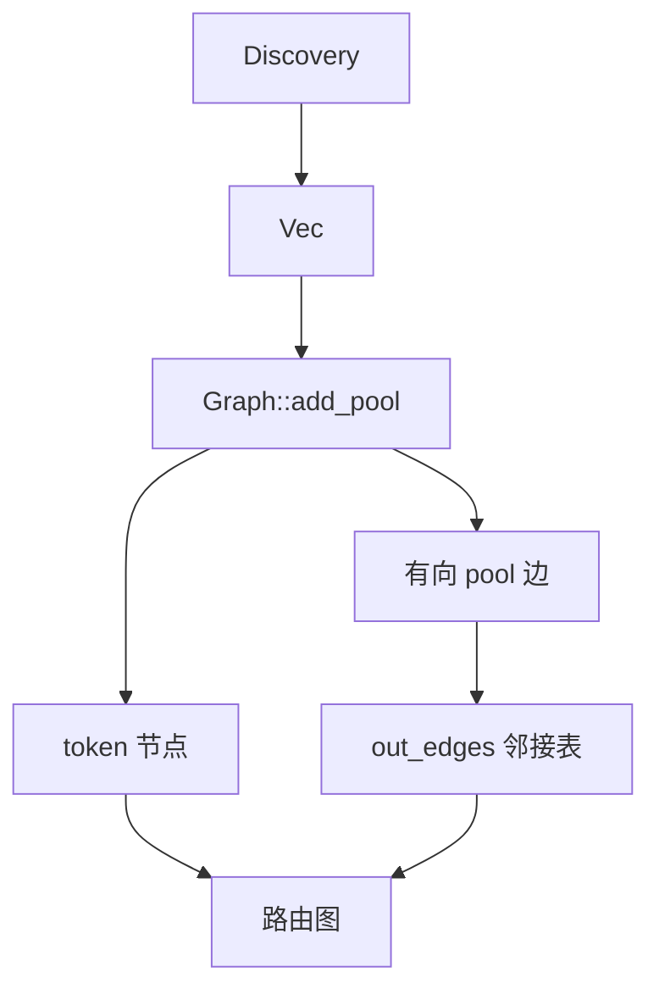
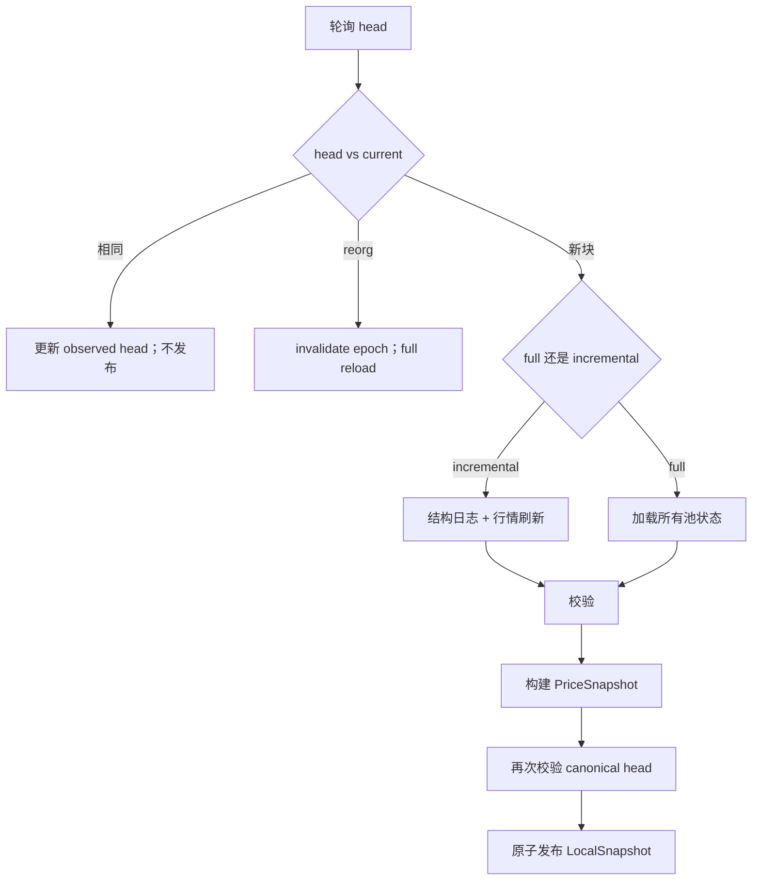
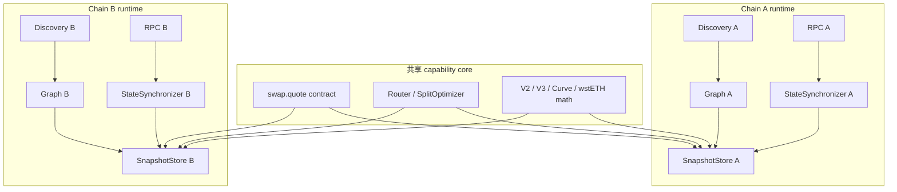

# swap.quote — Graph 与 Snapshot 生命周期

[English](GRAPH-AND-SNAPSHOT.md) · 中文

本文说明 `swap.quote` 如何构建路由图、图如何随时间变化，以及池状态如何在不混用不同区块高度、
不发布半成品数据的前提下保持更新。

本文也比较替代方案，并描述**未来多链目标**。多链目前只是设计目标：当前实现是 Ethereum 单链。

## 1. 范围与术语

| 术语 | 含义 |
|---|---|
| Graph | token 节点 + pool 有向边。 |
| Pool | 一个 AMM 或转换部署。 |
| Pair | 可交易的 token 对。一个 pair 可以有多个 pool。 |
| Edge | 某个 pool 内的一次有向兑换：`i -> j`。 |
| Topology | 存在哪些 token、pool 和 edge。 |
| State | reserves、V3 ticks、Curve balances、wstETH ratio。 |
| Snapshot | 某个区块上的不可变 graph + state + 粗选价格。 |
| Dirty pool | 当前区块范围内状态可能发生变化的 pool。 |

最重要的划分是：

```text
Topology freshness：存在哪些 pool 和 edge
State freshness：   某个区块上的 reserves / ticks / prices
```

两者的更新频率和失败模式不同。

## 2. 当前实现（单链）

### 2.1 Graph 构建



Discovery 从这些来源组装 pool 列表：

- Uniswap V2 / V3 subgraph
- Curve `AddressProvider` 和 registry
- ShibaSwap 和配置的 V2 fork，通过 `getPair`
- 配置的协议转换，例如 wstETH

然后 `Graph::add_pool` 做结构展开：

```text
for each pool:
    把每个 coin 注册为 token 节点
    for each 允许的有序币对 (i, j):
        追加 Edge { pool_idx, i, j }
        out_edges[token_i].push(edge_idx)
```

性质：

- token 按地址去重。
- 两币池产生 2 条有向边。
- 三币池产生 6 条有向边。
- 同一个 pair 的多个池保留为平行边。
- 转换边有方向性（`wrap` / `unwrap`）。
- Graph 只存拓扑。reserves 和 ticks 存在 snapshot 里。

相关代码：`crates/remote/src/graph.rs`、`crates/remote/src/model.rs`、
`crates/remote/src/discovery.rs`、`crates/remote/src/universe.rs`。

### 2.2 Graph 更新

运行时拓扑刷新使用**只增不减的 pending graph**：


规则：

- 新 pool 合并到克隆出来的 graph。
- 按 pool 地址去重。
- unsupported pool 会跳过，并单独报告。
- 当前已发布 graph 不会被修改。
- 请求读者继续使用旧 snapshot。
- 只有完整加载成功才能发布 pending graph。
- 加载失败不会发布 pending graph，旧 graph 保持不变。Incomplete 或 unsupported
  pending universe 会被丢弃。

当前限制：

```text
只增不减：运行时刷新永远不会删除 pool。
```

安全删除 pool 需要 quarantine 或确认窗口，避免一次临时 discovery 失败就删掉健康池。

相关代码：`crates/remote/src/main.rs`（`universe_refresh_secs`）、
`crates/remote/src/local_state.rs`（`queue_new_pools`、`graph_for_sync`、`publish`）。

### 2.3 Snapshot 更新

`StateSynchronizer` 是唯一持有 RPC client 的组件。它轮询 canonical head，并发布不可变
`LocalSnapshot` 版本。



当前平台行为：

| 平台 | 结构事件 | 当前刷新方式 |
|---|---|---|
| V2 / ShibaSwap | 未使用 | 所有池重新读 reserves。 |
| V3 | `Mint`、`Burn`、`Initialize` | 更新受影响 ticks；所有 V3 池重新读 `slot0` + `liquidity`。 |
| Curve | 未使用 | 所有 Curve 池 full reload。 |
| wstETH | 未使用 | 所有转换连接 full reload。 |

重要细节：

- V3 structure 通过 `Arc<V3Structure>` 共享。
- 不解析 V3 swap。所有 V3 池都会重新读 `slot0` 和 `liquidity`。
- 结构日志定位受影响的 V3 pool/tick，但行情字段仍然是全量刷新。
- `full_reload_interval_secs` 定期对账 incremental 更新。
- 大 gap、reorg 和不完整加载会强制 full reload。
- 新块可能发布失败；旧 snapshot 保留，但 age 会继续增长。
- 读者会拒绝 stale、lagging、reorg、incomplete 或 unsupported 快照。

`LocalSnapshot` 包含：

```text
block header
graph
FrozenSource（V2 reserves、V3 state、Curve state、wstETH state）
Router + 粗选 PriceSnapshot
epoch 和发布时间
```

它没有 RPC handle。报价计算是本地计算，在 `local_snapshot` 模式下执行 0 RPC。

相关代码：`crates/remote/src/local_state.rs`、`crates/remote/src/v3_sync.rs`、
`crates/remote/src/v3_local.rs`。

## 3. 设计空间

### 3.1 Graph 构建方案

| 方案 | 优点 | 缺点 | 适用 |
|---|---|---|---|
| Subgraph / indexer | 发现范围广、过滤丰富、查询便宜 | 索引延迟、依赖 provider、覆盖缺口 | 适合 V2/V3 广覆盖发现 |
| 链上 registry / factory | 权威、不需要 indexer | 调用多、接口特定、volume/age 过滤弱 | 适合 Curve、fork、校验 |
| 静态配置池列表 | 确定、可人工控制 | 手动、容易过期、不可扩展 | 适合测试和特殊池 |
| Pool-creation 事件 | 新池实时 | 需要完整日志历史、reorg 处理、事件解码 | 适合作为补充，不适合唯一来源 |
| Hybrid | 广覆盖 + 权威校验 | 代码和 reconciliation 更复杂 | 当前最佳方案 |

### 3.2 Graph 拓扑更新方案

| 方案 | 优点 | 缺点 |
|---|---|---|
| 定期 full rediscovery + replace | 能删除过期池；模型简单 | 成本高；discovery 失败会造成抖动 |
| 只增不减 pending graph（当前） | 对读者安全；池不会消失 | graph 会持续增长；不能删除 |
| Diff add/remove + quarantine | 准确且有界 | 需要确认窗口、reorg 处理、回滚 |
| Pool-creation 事件 + 定期对账 | 新池出现快 | 事件覆盖和 backfill 复杂 |
| Streaming/indexer 拓扑流 | 低延迟、少轮询 | 运维依赖和一致性风险 |

### 3.3 Snapshot 状态更新方案

| 方案 | 优点 | 缺点 |
|---|---|---|
| 每轮 full reload | 正确性模型最简单 | 池子变多后 RPC/CPU 成本高 |
| 当前 hybrid | 平衡较好；V3 structure 增量 | V2/Curve/wstETH 仍全量；所有 V3 行情字段刷新 |
| Dirty set + 精确刷新 | 只读变化池，同时保持 block hash 精确性 | 需要可靠日志、backfill、reorg 处理、事件覆盖 |
| 每 pool 订阅 + 事件 delta | 延迟最低 | 正确性难；订阅规模大；事件顺序；漏事件 |
| 外部 streaming/indexer state service | 可跨链、跨大量池扩展 | 新基础设施，需要设计延迟和一致性 |
| 请求时 lazy RPC | 总是最新 | 延迟高、限流、无法做 block 一致的多跳报价 |

### 3.4 为什么不能只用事件 delta

直接把事件 payload 应用到状态很诱人，但很脆弱：

- 一个块里可能有多笔 swap 碰到同一个池。
- `Mint` / `Burn` / `Swap` 事件可能交错。
- 一个事件不一定完整描述池的最终状态。
- Curve 事件不总是暴露完整 balances。
- 漏日志或重复日志会静默破坏状态。
- reorg 回滚比重新读最终状态更难。

更安全的规则是：

```text
事件负责选出 dirty pool。
精确状态读取负责决定目标 block hash 上的最终状态。
```

## 4. 推荐演进路线

推荐目标是：

```text
事件驱动 dirty set
+ block hash 上精确刷新状态
+ 不可变 snapshot
+ 周期性 full reconciliation
+ 按链分片
```

这在保持当前正确性模型的同时减少不必要的工作。

### Phase 1：当前基线

- 单链。
- 只增不减的拓扑更新。
- V3 结构增量 + 所有 V3 行情字段。
- V2/Curve/wstETH full refresh。
- 原子 snapshot 发布和新鲜度门禁。

### Phase 2：dirty-set 状态刷新

增加每个平台的状态事件集合：

| 平台 | 状态事件 | Dirty 动作 |
|---|---|---|
| V2 / ShibaSwap | `Swap`、`Sync`、`Mint`、`Burn` | 只重读 dirty pool 的 reserves。 |
| V3 | `Swap`、`Mint`、`Burn`、`Initialize` | 只重读 dirty pool 的 `slot0`/`liquidity`；更新受影响 ticks。 |
| Curve | `TokenExchange`、`TokenExchangeUnderlying`、add/remove liquidity | 只重读 dirty pool 的状态。 |
| wstETH | 没有稳定的 pool 事件 | 保留周期/full refresh，或增加 Lido 专用事件。 |

然后：

```text
区块范围 logs
  → dirty pool 集合
  → 在 block hash 上精确 multicall
  → 与上一个 snapshot 合并
  → 发布
```

仍然保留周期性 full reconciliation，用来兜住漏事件、未知池类型和外部状态变化。

### Phase 3：Graph diff 与规模化

- 用 quarantine 和确认窗口做 pool add/remove。
- 对 dirty edges 增量更新 `PriceSnapshot`，而不是每次重建所有边。
- 按链和平台拆分 state worker。
- 增加每链 RPC pool 和限流。
- 增加候选裁剪和每链 snapshot 上限。

### Phase 4：多链

多链是数据模型变更，不只是配置变更。

## 5. 多链目标设计

多链**尚未实现**。本节是未来设计目标。

### 5.1 当前单链假设

| 领域 | 当前假设 |
|---|---|
| Config | 一个 `rpc_url`、一组 subgraph、一个 Curve provider。 |
| Graph | token 和 pool key 只有 `Address`。 |
| Pool | 没有 `chain_id`。 |
| Snapshot | 每个 server 一个 `SnapshotStore` 和一个 `Graph`。 |
| Request | `swap.quote` 请求没有 chain 字段。 |
| Response | `chain` 是字符串标签；没有 chain id。 |
| Client | `chain = "ethereum"` 写死。 |
| Finality | 一套 `max_age_secs` / `max_lag_blocks` 策略。 |

增加第二条链之前，这些假设都必须改变。

### 5.2 身份模型变更

引入链级身份：

```text
ChainId(u64)
AssetId { chain_id, address }
PoolId  { chain_id, address }
```

Graph 节点和边绝不能让不同链上相同的 `Address` 冲突。

### 5.3 每链 runtime



规则：

- 每条链一个 graph。同一个 graph 里没有跨链边。
- 每条链一个 snapshot store。
- 每条链一个 synchronizer，各自拥有 RPC 和新鲜度策略。
- Router 和 split 是共享代码，但只操作一条链的 graph。
- `swap.quote` 显式选择一条链；不会静默混合多条链。
- 跨链 swap 是另一个 capability，不是 `swap.quote` 里的隐藏路由。

### 5.4 链配置

```text
ChainConfig {
  chain_id,
  rpc_urls,
  subgraph_ids,
  curve_provider,
  enabled_platforms,
  finality / reorg policy,
  poll_interval,
  max_age_secs,
  max_lag_blocks,
  batch sizes
}
```

### 5.5 新鲜度与最终性

必须按链配置策略：

- L1 和 L2 的 block time、reorg depth 不同。
- 有些链支持 safe/finalized tag；有些 RPC 不支持。
- `max_age_secs` 和 `max_lag_blocks` 不能是全局常量。
- 响应应暴露 `chain_id`、block number、block hash 和 finality metadata。
- stale/lagging/reorg 错误仍然按链显式返回。

### 5.6 API 与路由边界

请求必须标识 chain，例如：

```text
POST /quote  { chain_id, token_in, token_out, amount_in, ... }
```

或者使用 chain-scoped route。具体 transport 形态是单独的契约决策。

规则：

- `swap.quote` 只在一条链内路由。
- 多链存在后，没有 chain 的 token 地址是歧义的。
- 报价响应必须带 `chain_id`。
- 跨链路由需要 bridge/execution capability 和显式用户授权。

## 6. 规模化：更多池子和 pair

### 6.1 增长来源

- 多币池展开为 `n * (n - 1)` 条边。
- 平行池给同一个 pair 增加平行边。
- pair 增多会增加候选搜索和精确精算的工作量。
- 链增多会乘以独立的 graph 和状态流水线。

### 6.2 成本中心

| 成本 | 当前驱动 |
|---|---|
| RPC 读取 | 所有 V3 行情字段；V2/Curve/wstETH full refresh |
| Logs | V3 结构日志；未来 dirty-set topics |
| CPU | `PriceSnapshot` 重建；K-best DP；拆单搜索 |
| 内存 | Graph edges；V3 structures；读者持有的 snapshots |
| Discovery | subgraph 分页、factory pairs、Curve registry 枚举 |

### 6.3 扩展手段

- dirty-set 状态刷新。
- 对 dirty edges 增量更新 `PriceSnapshot`。
- 带 quarantine 的 graph add/remove diff。
- 按链、按平台的 worker 分片。
- 候选裁剪、`max_hops`、`top_k`、family diversity、reserve filters。
- 批量 multicall 和 log chunking。
- snapshot refcount retirement 和有界旧版本保留。
- 监控 RPC 成本、dirty-pool 比例、snapshot age、lag、full reload 耗时。

## 7. 推荐目标总结

```text
Topology:
  hybrid discovery
  + add/remove diffs
  + quarantine
  + 周期性 full reconcile
  + 原子 pending graph

State:
  事件驱动 dirty set
  + block hash 上精确读状态
  + V3 结构 ticks
  + 周期性 full reconcile
  + 不可变 snapshot 发布
  + 每链新鲜度门禁

Multi-chain:
  chain-scoped AssetId / PoolId
  + 每链一个 graph 和 snapshot store
  + 共享 router / split / math
  + swap.quote 内没有跨链边
```

核心原则：

> **事件只指出哪些东西可能变了；精确状态读取决定 snapshot 里最终是什么。**

## 8. 开放问题

- 我们需要池子删除，还是下一阶段重启/改配置就够？
- Ethereum 之后先上哪些链，它们需要什么 finality/reorg 策略？
- Discovery 应该用 Substreams/Firehose、WebSocket logs，还是 HTTP log polling？
- 多链是通过 `/quote` 的 chain 字段暴露，还是 chain-scoped endpoint？
- 需要外部 state/indexer service，还是每链进程内同步？
- `PriceSnapshot` 应该重建，还是对 dirty edges 增量更新？
- retired snapshots 应保留多久，用于审计/调试？

## 9. 代码位置

| 领域 | 代码 |
|---|---|
| Graph 节点、边、邻接表 | `crates/remote/src/graph.rs` |
| Pool 和 edge 类型 | `crates/remote/src/model.rs` |
| Discovery 来源和过滤 | `crates/remote/src/discovery.rs`、`universe.rs` |
| Pending graph 和 snapshot store | `crates/remote/src/local_state.rs` |
| Synchronizer 和新鲜度门禁 | `crates/remote/src/local_state.rs` |
| V3 结构和行情刷新 | `crates/remote/src/v3_sync.rs`、`v3_local.rs` |
| HTTP 准入和 snapshot lease | `crates/remote/src/api.rs` |
| 启动和 universe 刷新 | `crates/remote/src/main.rs` |
| 链和平台配置 | `crates/remote/src/config.rs` |
