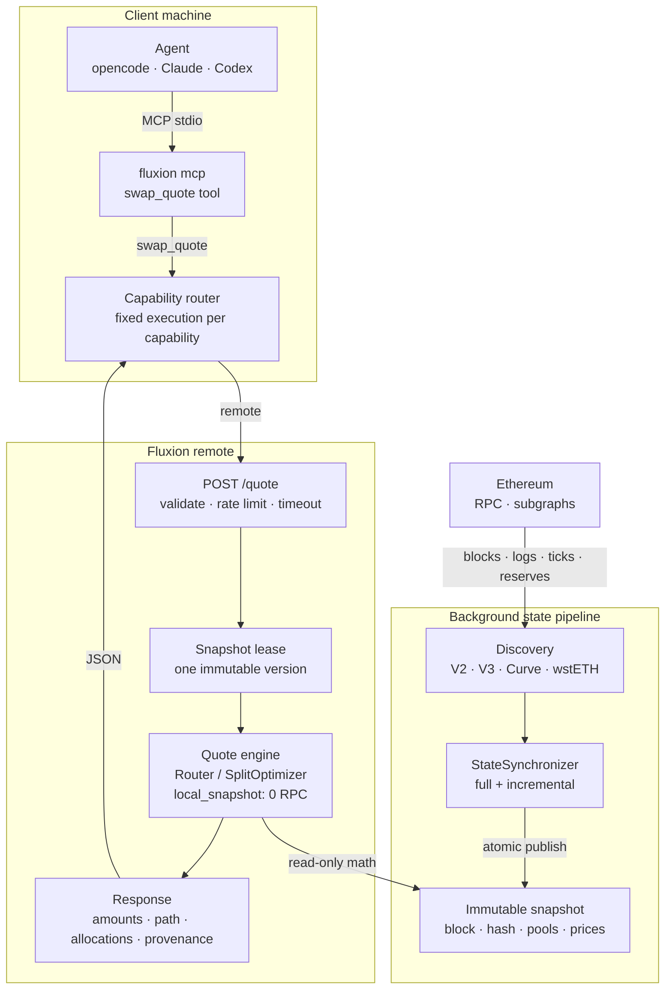

# swap.quote

`swap.quote` is Fluxion's first capability: an exact-in swap quote on Ethereum mainnet. It returns
amounts, split allocations, hop paths and state provenance. It is read-only and never signs,
approves, or broadcasts.

## Execution model

`swap.quote` always uses the remote Fluxion service; `wallet` / `execute` capabilities use the
local runtime. Agents and users do not choose local/remote.

The remote endpoint is configured with `FLUXION_REMOTE_URL` (or `--url`); authentication and
registration live in [docs/MCP.md](../../MCP.md). This is endpoint configuration, not an execution
mode.

## Architecture

`swap.quote` runs in two pricing modes: `local_snapshot` (default) and legacy `rpc`. In
`local_snapshot`, the request path reads one immutable snapshot and RPC belongs to the background
synchronizer. The diagram shows that mode; in `rpc` mode the request path calls live adapters
instead of the frozen snapshot.



### Request path

1. **MCP entry.** `fluxion mcp` exposes the `swap_quote` tool and maps its arguments to
   `POST /quote`. There is no local/remote selector.
2. **Admission.** The API validates addresses and amounts, applies the rate limit, acquires a
   bounded compute slot and leases the current snapshot. If no complete snapshot is ready, or it is
   stale, lagging, reorged or incomplete, the request returns an explicit state error; it never
   falls back to request-time RPC.
3. **Route or split.** Without split, `Router::route` returns the best single route. With split,
   `SplitOptimizer` keeps the single-route baseline and searches for a better allocation.
4. **Bounded compute.** Both paths run in a blocking worker. Quote math reads only the leased
   snapshot's frozen pool state and coarse prices.
5. **Response.** The API returns exact amounts, hop paths, allocations, `quote_block`, state
   freshness, search statistics and provenance. `amount_out_min` is checked after optimization.

### Background path

1. **Discovery.** The graph is built from the configured V2, V3, Curve and wstETH universe.
2. **Synchronization.** `StateSynchronizer` reads the canonical head and loads pool state. Full
   mode rebuilds the universe; incremental mode applies structural logs and refreshes fast fields,
   falling back to a full rebuild on gaps, reorgs or incomplete data.
3. **Validation and publish.** State is built and validated in a bounded writer. A complete
   snapshot is published atomically with its block hash, timestamp, graph, frozen pool states and
   coarse prices. Partial state is never published.
4. **Reader isolation.** In-flight requests keep their old snapshot version. Retired snapshots are
   reclaimed by the writer after readers leave.
5. **Freshness.** Stale, lagging, reorged and incomplete states are distinct errors. The remote
   never silently reduces the pool universe to make a quote succeed.

### Routing pipeline

- **Graph.** Tokens are nodes; pools are directed edges. Parallel pools remain parallel edges, and
  multi-coin pools expand into every ordered pair.
- **Coarse search.** A precomputed `PriceSnapshot` supplies mid-price and input reserve per edge.
  K-best DP searches up to `max_hops` with a simple-path constraint, fee penalties and optional
  liquidity penalties. Direct pools are always considered so a cheap-looking multi-hop path cannot
  hide the obvious route.
- **Exact refine.** Top-K candidates are re-quoted with the platform's integer math: V2 constant
  product, V3 tick crossing, Curve StableSwap/CryptoSwap and wstETH conversion. The best exact
  `amount_out` wins.
- **Split search.** The baseline is retained unless a candidate beats it. The optimizer uses
  coarse-to-fine two-route allocation, disjoint multi-hop branches and discrete DP for multi-pool
  allocation, with request-local quote caching, quote budgets and deadlines.
- **Invariants.** One request uses one snapshot version; local computation performs zero RPC;
  amounts use protocol integer rounding; incomplete coverage is an error, not a silent fallback.

| Stage | Code |
|---|---|
| HTTP API and admission | `crates/remote/src/api.rs` |
| Snapshot, sync and leases | `crates/remote/src/local_state.rs` |
| Graph and pool edges | `crates/remote/src/graph.rs` |
| Coarse search and exact refine | `crates/remote/src/router.rs` |
| Split optimization | `crates/remote/src/split.rs` |
| V2 / V3 / Curve / wstETH math | `crates/remote/src/adapters.rs`, `v3_local.rs`, `curve_local.rs`, `wsteth_local.rs` |

## Quick start

```bash
fluxion swap ldo-eth 100
fluxion swap ldo-eth 100 --json
fluxion capability describe swap.quote --json
```

Machine interface:

```bash
fluxion swap quote --in LDO --out ETH --amount 100 --json
```

MCP tool: `swap_quote` with `token_in`, `token_out`, `amount`, optional `max_hops`, `split`,
`split_max_branches`, `decimals_in`, `decimals_out`.

## MCP

Tool name: `swap_quote`.

Project-level MCP installation, client registration, execution routing and troubleshooting live in
[docs/MCP.md](../../MCP.md). This capability document only defines the tool contract.

## Inputs

| Field | Required | Description |
|---|---|---|
| `token_in` / `token_out` | yes | Symbol (`LDO`, `ETH`, `USDC`) or `0x` address |
| `amount` | yes | Human units, e.g. `100` or `0.5` |
| `decimals_in` / `decimals_out` | no | Required for unknown `0x` addresses |
| `max_hops` | no | Maximum route hops |
| `split` | no | Default true; allocate across independent pools/routes |
| `split_max_branches` | no | Maximum split branches |

## Output

The response follows [`schemas/swap_quote.v1.json`](../../../schemas/swap_quote.v1.json).
Important fields:

- `amount_in`, `amount_out`: exact `raw` integer and display `decimal`
- `plan_kind`: `baseline`, `direct`, or `split`
- `allocations`: exact per-branch inputs, outputs and hop paths
- `provenance.execution`: always `remote` for `swap.quote`
- `provenance.pricing_mode`: `rpc` or `local_snapshot`
- `quote_block`, `state_age_secs`, `lag_blocks`: freshness
- `latency_ms`: runtime quote latency

Warm local-snapshot quotes are typically 5–30 ms in the current benchmark environment. State
freshness is measured separately from latency.

## Latest benchmark

90 rows on 4 Nov 2026, 209 pool/conversion records, full-range V3:

| Metric | Result |
|---|---:|
| Snapshot lag blocks p50/p95/max | **0 / 1 / 1** |
| Snapshot lag seconds p50/p95/max | **0 / 12 / 12 s** |
| Fluxion HTTP p50/p95 | **49 / 133 ms** |
| Success | **90 / 90** |
| ParaSwap mean delta / within ±50 bps | **−2.6 bps / 89** |
| 1inch mean delta / within ±50 bps | **−8.7 bps / 82** |

Split allocation includes disjoint multi-hop routes. Remaining large-order gaps are mostly venue
coverage limits (for example LDO and SHIB), not freshness or allocation. Full methodology:
[90-row report](../../benchmarks/quote-freshness-2026-11-04-route-split.md) ·
[benchmark index](../../benchmarks/README.md).

## Errors

Errors use stable codes rather than free-form text:

`INVALID_ARGUMENT`, `NO_PATH`, `INSUFFICIENT_LIQUIDITY`, `AMOUNT_OUT_BELOW_MIN`, `RPC_ERROR`,
`STALE_STATE`, `STATE_INCOMPLETE`, `UNSUPPORTED`, `TIMEOUT`, `INTERNAL`.

CLI exit codes: `2` invalid argument, `3` no path/liquidity, `4` RPC/unsupported, `5` stale state,
`6` timeout, `1` internal.

## Boundaries

- Read-only: this capability does not construct, simulate, sign, or execute transactions.
- `swap.build`, `swap.simulate`, and `swap.execute` are future local-only capabilities.
- A successful quote is not a guarantee of execution; re-check freshness, slippage, gas, MEV and
  user authorization before acting.
- Skills are documentation, not a security boundary.

## Related

- [Capability index](../README.md)
- [Agent skill](../../../skills/swap/SKILL.md)
- [JSON schema](../../../schemas/swap_quote.v1.json)
- [Project whitepaper](../../WHITEPAPER.md)
- [Latest benchmark](../../benchmarks/quote-freshness-2026-11-04-route-split.md)
- [Root README](../../../README.md)
