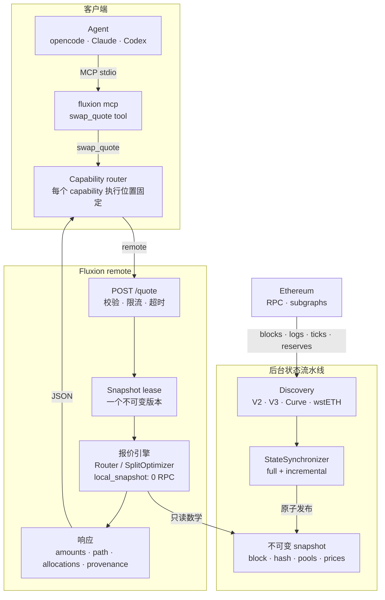

# swap.quote

[English](README.md) · 中文

`swap.quote` 是 Fluxion 的第一个 capability：Ethereum mainnet 上的 exact-in swap 报价。它返回
金额、拆单分配、hop 路径和状态来源信息。`swap.build` 把单条 V2 allocation 转成 router
calldata。两者都只读，不签名、不授权、不广播。

## `swap.build`

```bash
fluxion swap quote --in USDC --out WETH --amount 100 --json > /tmp/quote.json
fluxion swap build --quote /tmp/quote.json --recipient 0x... --slippage-bps 50 --json
```

- 只支持 Ethereum。
- 只支持单条 allocation，hop 必须全部是 `uniswap-v2`。
- 输出 `router`、`data`、`value`、`amount_out_min`、`deadline`、`path`、`hops`。
- 拒绝拆单、嵌套 allocation、V3、Curve 和断开的 hop。
- schema：`schemas/swap_build.v1.json`。

## 执行模型

`swap.quote` 固定使用远程 Fluxion 服务；`swap.build` 和 `wallet` / `execute` capability 使用
local runtime。Agent 和用户都不选择 local/remote。

远程 endpoint 通过 `FLUXION_REMOTE_URL`（或 `--url`）配置；认证和注册见
[docs/MCP.md](../../MCP.md)。这是 endpoint 配置，不是执行模式。

## 架构

`swap.quote` 有两种定价模式：`local_snapshot`（默认）和旧版 `rpc`。在 `local_snapshot` 中，
请求路径只读取一个不可变 snapshot，RPC 属于后台 synchronizer。下图展示的是这种模式；在
`rpc` 模式下，请求路径调用 live adapters，而不是冻结 snapshot。

完整的请求、路由、拆单搜索和后台状态流程见
[端到端技术流程](ARCHITECTURE.zh.md)。Graph 构建、拓扑更新、snapshot 刷新方案、规模化限制
和未来多链设计见 [Graph 与 Snapshot 生命周期](GRAPH-AND-SNAPSHOT.zh.md)。



### 请求路径

1. **MCP 入口。** `fluxion mcp` 暴露 `swap_quote` tool，并把参数映射为 `POST /quote`。没有
   local/remote 选择器。
2. **请求准入。** API 校验地址和金额，应用限流，获取有界 compute slot，并租用当前 snapshot。
   如果没有完整 snapshot，或者 snapshot 过期、落后、reorg、不完整，请求返回显式状态错误；
   永远不会回退到请求时 RPC。
3. **单路径或拆单。** 不拆单时，`Router::route` 返回最优单路径。拆单时，`SplitOptimizer`
   保留单路径 baseline，并搜索更优分配。
4. **有界计算。** 两条路径都在 blocking worker 中运行。报价数学只读取租用 snapshot 的冻结池状态
   和粗选价格。
5. **响应。** API 返回精确金额、hop 路径、allocations、`quote_block`、状态新鲜度、搜索统计和
   provenance。`amount_out_min` 在优化之后检查。

### 后台路径

1. **Discovery。** 从配置的 V2、V3、Curve 和 wstETH universe 构建 graph。
2. **同步。** `StateSynchronizer` 读取 canonical head 并加载池状态。Full 模式重建 universe；
   incremental 模式应用结构日志并刷新快速变化字段，在 gap、reorg 或不完整数据时回退 full rebuild。
3. **校验和发布。** 状态在有界 writer 中构建和校验。完整 snapshot 带 block hash、timestamp、
   graph、冻结池状态和粗选价格，原子发布。半成品状态永不发布。
4. **读者隔离。** 在途请求继续持有旧 snapshot 版本。retired snapshots 在读者离开后由 writer 回收。
5. **新鲜度。** stale、lagging、reorg、incomplete 是不同错误。remote 永远不会为了让报价成功而
   静默缩小池子集合。

### 路由流水线

- **Graph。** token 是节点；pool 是有向边。平行池保留平行边，多币池展开成所有有序币对。
- **粗选。** 预计算的 `PriceSnapshot` 提供每条边的 mid-price 和 input reserve。K-best DP 在
  `max_hops` 内搜索，带 simple-path 约束、fee penalty 和可选 liquidity penalty。直接池永远会
  被考虑，避免看似便宜的多跳路径掩盖明显路线。
- **精确精算。** Top-K 候选使用平台整数数学重新报价：V2 constant product、V3 tick crossing、
  Curve StableSwap/CryptoSwap 和 wstETH conversion。最优 exact `amount_out` 胜出。
- **拆单搜索。** 除非候选严格更优，否则保留 baseline。优化器使用 coarse-to-fine 两路径分配、
  disjoint 多跳分支和多池离散 DP，并带请求级报价缓存、报价预算和 deadline。
- **不变量。** 一个请求只使用一个 snapshot 版本；本地计算执行 0 RPC；金额使用协议整数舍入；
  覆盖不完整是错误，不是静默回退。

| 阶段 | 代码 |
|---|---|
| HTTP API 和请求准入 | `crates/remote/src/api.rs` |
| Snapshot、sync 和 leases | `crates/remote/src/local_state.rs` |
| Graph 和 pool edges | `crates/remote/src/graph.rs` |
| 粗选和精确精算 | `crates/remote/src/router.rs` |
| 拆单优化 | `crates/remote/src/split.rs` |
| V2 / V3 / Curve / wstETH 数学 | `crates/remote/src/adapters.rs`、`v3_local.rs`、`curve_local.rs`、`wsteth_local.rs` |

## 快速开始

```bash
fluxion swap ldo-eth 100
fluxion swap ldo-eth 100 --json
fluxion capability describe swap.quote --json
```

机器接口：

```bash
fluxion swap quote --in LDO --out ETH --amount 100 --json
```

MCP tool：`swap_quote`，参数为 `token_in`、`token_out`、`amount`，可选 `max_hops`、`split`、
`split_max_branches`、`decimals_in`、`decimals_out`。

## MCP

Tool 名称：`swap_quote`。

项目级 MCP 安装、客户端注册、执行路由和排错见 [docs/MCP.md](../../MCP.md)。本 capability
文档只定义 tool contract。

## 输入

| 字段 | 必填 | 说明 |
|---|---|---|
| `token_in` / `token_out` | 是 | Symbol（`LDO`、`ETH`、`USDC`）或 `0x` 地址 |
| `amount` | 是 | 人类单位，例如 `100` 或 `0.5` |
| `decimals_in` / `decimals_out` | 否 | 未知 `0x` 地址必填 |
| `max_hops` | 否 | 最大路由 hops |
| `split` | 否 | 默认 true；在独立池/路径间分配 |
| `split_max_branches` | 否 | 最大拆单分支数 |

## 输出

响应遵循 [`schemas/swap_quote.v1.json`](../../../schemas/swap_quote.v1.json)。重要字段：

- `amount_in`、`amount_out`：精确 `raw` 整数和展示用 `decimal`
- `plan_kind`：`baseline`、`direct` 或 `split`
- `allocations`：每个分支的精确输入、输出和 hop 路径
- `provenance.execution`：`swap.quote` 永远为 `remote`
- `provenance.pricing_mode`：`rpc` 或 `local_snapshot`
- `quote_block`、`state_age_secs`、`lag_blocks`：新鲜度
- `latency_ms`：运行时报价延迟

在当前 benchmark 环境中，热 local-snapshot 报价通常在 5–30 ms。状态新鲜度和延迟分开度量。

## 最新 benchmark

2026-11-04 的 90 行、209 条池/转换记录、full-range V3：

| 指标 | 结果 |
|---|---:|
| 快照落后区块 p50/p95/max | **0 / 1 / 1** |
| 快照落后时间 p50/p95/max | **0 / 12 / 12 s** |
| Fluxion HTTP p50/p95 | **49 / 133 ms** |
| 成功率 | **90 / 90** |
| ParaSwap 平均偏差 / ±50 bps 内 | **−2.6 bps / 89** |
| 1inch 平均偏差 / ±50 bps 内 | **−8.7 bps / 82** |

拆单包含互不共享池的多跳路径。剩余大额差距主要是 venue 覆盖限制（例如 LDO 和 SHIB），不是
新鲜度或分配问题。完整方法：
[90 行报告](../../benchmarks/quote-freshness-2026-11-04-route-split.md) ·
[benchmark 索引](../../benchmarks/README.md)。

## 错误

错误使用稳定错误码，而不是自由文本：

`INVALID_ARGUMENT`、`NO_PATH`、`INSUFFICIENT_LIQUIDITY`、`AMOUNT_OUT_BELOW_MIN`、`RPC_ERROR`、
`STALE_STATE`、`STATE_INCOMPLETE`、`UNSUPPORTED`、`TIMEOUT`、`INTERNAL`。

CLI 退出码：`2` 参数错误，`3` 无路径/流动性，`4` RPC/不支持，`5` stale state，`6` 超时，
`1` internal。

## 边界

- 只读：本 capability 不构造、不模拟、不签名、不执行交易。
- `swap.simulate`、`swap.execute` 和通用 `transaction.send` 是未来 local-only capability；`swap.build` 已可用。
- 报价成功不代表执行保证；执行前必须重新检查新鲜度、滑点、gas、MEV 和用户授权。
- Skills 是文档，不是安全边界。

## 相关

- [Capability index](../README.md)
- [Agent skill](../../../skills/swap/SKILL.md)
- [JSON schema](../../../schemas/swap_quote.v1.json)
- [项目白皮书](../../WHITEPAPER.md)
- [最新 benchmark](../../benchmarks/quote-freshness-2026-11-04-route-split.md)
- [根 README](../../../README.md)
